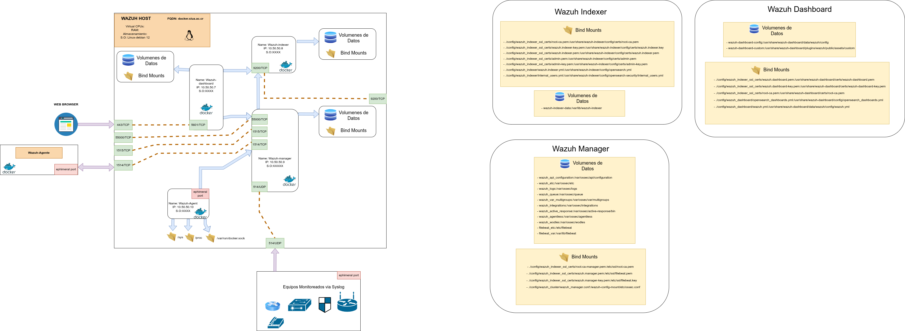
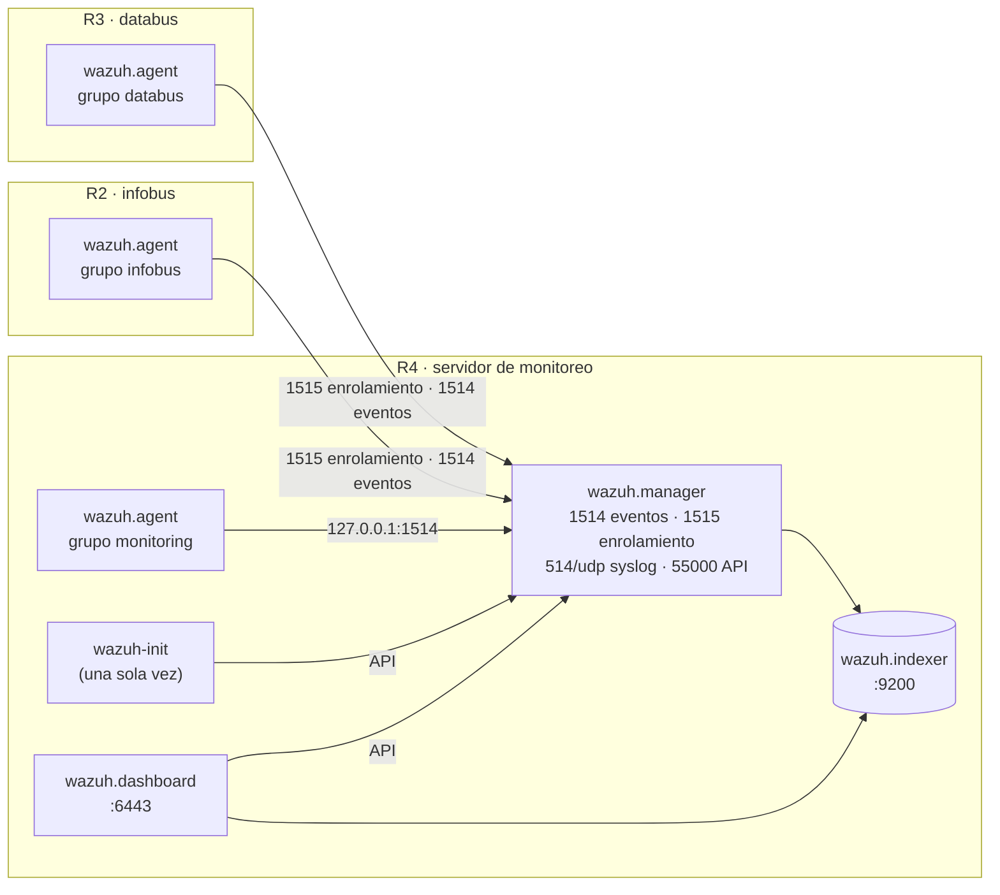
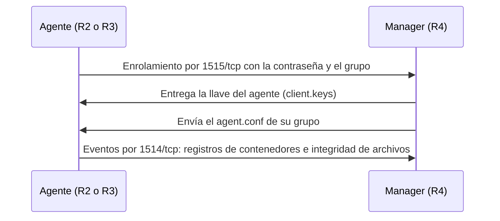

# Wazuh · seguridad de databus e infobus

[English](README.md) · **Español**


Despliegue con Docker Compose de Wazuh (single-node) para vigilar la seguridad de [databus](https://github.com/simovilab/databus), [infobus](https://github.com/simovilab/infobus) y del propio sistema de monitoreo. El repositorio trae dos modos:

- **Servidor (`server`):** Wazuh Indexer, Wazuh Manager y Wazuh Dashboard. Incluye el contenedor `wazuh-init`, que crea los grupos de agentes, su configuración y las reglas del proyecto por API, y un agente local en el grupo `monitoring`.
- **Agente (`agent`):** un agente de Wazuh en Docker en cada servidor de aplicación. Se enrola solo en su grupo (`databus` o `infobus`) con una contraseña de enrolamiento. Lee los registros de los contenedores y vigila la integridad de los archivos del despliegue.



## Arquitectura

| Servicio | Dónde | Función | Tecnología |
| --- | --- | --- | --- |
| **wazuh.indexer** | Servidor | Guarda y busca las alertas y los eventos | Wazuh Indexer 4.14.5 (OpenSearch) |
| **wazuh.manager** | Servidor | Recibe los eventos de los agentes, aplica las reglas y dispara la respuesta activa | Wazuh Manager 4.14.5 |
| **wazuh.dashboard** | Servidor | Interfaz web | Wazuh Dashboard 4.14.5 |
| **wazuh-init** | Servidor | Crea grupos, configuración por grupo y reglas por API. Corre una vez y termina | alpine/curl + bash + jq |
| **wazuh.agent** | Servidor | Agente local en el grupo `monitoring`, con red del host para que la respuesta activa bloquee en el firewall real | Wazuh Agent 4.14.5 |
| **wazuh.agent** | Cada servidor de aplicación | Agente en el grupo `databus` o `infobus` | Wazuh Agent 4.14.5 |



## Servidor

El servidor va en la máquina de monitoreo (R4), junto al servidor de Zabbix. Se levanta con [`docker-compose.yml`](docker-compose.yml).

### Quick start

```bash
git clone -b wazuh-fase-3 https://github.com/rsol9000-01/wazuh.git /home/wazuh
cd /home/wazuh
cp .env.example .env     # reemplazar todos los "CAMBIAR" (ver abajo)
sudo ./scripts/wazuh-dev.sh server
```

La interfaz queda en `https://<servidor>:6443`, con el usuario `MY_USERNAME` y la contraseña `MY_PASSWORD` del `.env`. El certificado es autofirmado, así que el navegador muestra una advertencia la primera vez.

### How to

#### 1. Requisitos

- Linux con Docker Engine y Docker Compose v2. El grupo `docker` tiene que existir.
- Ejecutar el script como **root** (`sudo`). El script hace tres cosas que lo requieren:
  - Sube `vm.max_map_count` a 262144, que el indexer necesita, y lo deja fijo en `/etc/sysctl.conf`.
  - Instala `rsyslog` si no existe `/var/log/auth.log`, para que lleguen los eventos de SSH.
  - Instala `curl` si falta.
- Memoria suficiente para el indexer, que arranca con 1 GB de heap (`OPENSEARCH_JAVA_OPTS`).
- Puertos abiertos en el firewall del servidor:

| Puerto | Uso |
| --- | --- |
| `1514/tcp` | Eventos de los agentes |
| `1515/tcp` | Enrolamiento de agentes |
| `514/udp` | Syslog |
| `55000/tcp` | API del manager |
| `9200/tcp` | API del indexer |
| `6443/tcp` | Interfaz web (HTTPS) |

#### 2. Configurar el `.env`

Copiar `.env.example` a `.env` y reemplazar todos los `CAMBIAR`. El `.env` está en `.gitignore`: no subirlo nunca al repositorio.

| Variable | Ejemplo | Qué es |
| --- | --- | --- |
| `MY_USERNAME`, `MY_PASSWORD` | `tfgadmin` / *(propia)* | Usuario administrador propio para la interfaz web. El script lo crea o actualiza en el indexer |
| `INDEXER_PASSWORD` | *(propia)* | Contraseña del usuario interno `admin` del indexer. Ver la advertencia de abajo |
| `API_PASSWORD` | *(propia)* | Contraseña del usuario `wazuh-wui` de la API del manager |
| `DASHBOARD_PASSWORD` | *(propia)* | Contraseña del usuario interno `kibanaserver`, con el que el dashboard habla con el indexer |
| `AGENT_AUTH_PASSWORD` | *(propia)* | Contraseña de enrolamiento de agentes. La misma va en el `.env` de cada agente |
| `DATABUS_PATH`, `INFOBUS_PATH` | `/home/databus`, `/home/infobus` | Rutas de databus e infobus **en el host de cada agente**. Se usan para la vigilancia de integridad (FIM) |
| `WAZUH_PATH`, `ZABBIX_PATH` | `/home/wazuh`, `/home/zabbix` | Rutas de este repositorio y del de Zabbix en el servidor. El agente local vigila su integridad |
| `TZ` | `America/Costa_Rica` | Zona horaria |

`API_PASSWORD`, `DASHBOARD_PASSWORD` y `AGENT_AUTH_PASSWORD` tienen que cumplir esto, o el script las rechaza:

- Entre 8 y 64 caracteres.
- Al menos una mayúscula, una minúscula, un número y uno de `. * + ? -`.
- Sin `$`, `|`, `&` ni `\`.

> **Contraseña de `admin` del indexer.** El script actualiza el hash de `MY_USERNAME` y de `kibanaserver` en `config/wazuh_indexer/internal_users.yml`, pero **no** el de `admin`. Ese usuario conserva el hash que trae `internal_users.yml.template`, y `INDEXER_PASSWORD` tiene que ser la contraseña de ese hash. Si no se conoce, definir una propia antes del primer despliegue:
>
> ```bash
> cp config/wazuh_indexer/internal_users.yml.template config/wazuh_indexer/internal_users.yml
> docker run --rm wazuh/wazuh-indexer:4.14.5 \
>   /usr/share/wazuh-indexer/plugins/opensearch-security/tools/hash.sh -p 'MiClaveIndexer.2026'
> ```
>
> Copiar el hash que imprime en la línea `hash:` del usuario `admin` de `internal_users.yml`, y poner esa misma contraseña en `INDEXER_PASSWORD`.

#### 3. Desplegar

```bash
cd /home/wazuh
sudo ./scripts/wazuh-dev.sh server
```

El script hace esto, en orden:

1. Ajusta `vm.max_map_count`, verifica Docker y el grupo `docker`, y prepara `curl` y `rsyslog`.
2. Crea, si no existen, `config/wazuh_indexer/internal_users.yml` y `config/wazuh_dashboard/wazuh.yml` a partir de sus plantillas.
3. Escribe `API_PASSWORD` en `wazuh.yml` y crea o actualiza los hashes de `MY_USERNAME` y `kibanaserver`.
4. Guarda `AGENT_AUTH_PASSWORD` en `config/wazuh_cluster/authd.pass`, que el manager usa para validar el enrolamiento.
5. Genera los certificados autofirmados de los tres componentes en `config/wazuh_indexer_ssl_certs/`.
6. Levanta el stack con `docker compose up -d`.

El arranque completo tarda varios minutos: el dashboard espera a que el indexer y el manager estén sanos.

#### 4. Qué configura `wazuh-init`

`wazuh-init` corre [`scripts/wazuh-manager-conf.sh`](scripts/wazuh-manager-conf.sh) contra la API del manager. Se puede volver a correr sin duplicar nada:

1. Crea los grupos `databus`, `infobus` y `monitoring`.
2. Sube el `agent.conf` de cada grupo: qué registros lee el agente y qué rutas vigila la integridad (ver [Grupos de agentes](#grupos-de-agentes)).
3. Sube `local_rules.xml` con las reglas del proyecto (ver [Reglas del proyecto](#reglas-del-proyecto)).
4. Valida la configuración y solo si es válida reinicia el manager.

Cuando termina, arranca el agente local, que se enrola en el grupo `monitoring`.

#### 5. Verificar

```bash
docker compose ps                                      # indexer, manager y dashboard en healthy; wazuh-init en exited (0)
docker compose logs wazuh-init | tail -20              # termina con "The manager is ready to accept registrations"
docker exec wazuh.manager /var/ossec/bin/agent_control -l   # agentes enrolados y su estado
```

En la web: **Agents** muestra el agente local en el grupo `monitoring`, en estado *Active*.

#### Cambiar `wazuh_manager.conf` en una instalación existente

El archivo `config/wazuh_cluster/wazuh_manager.conf` se monta en el contenedor. Al arrancar, la imagen lo copia a `/var/ossec/etc/ossec.conf`, pero **solo en el primer arranque**: en la imagen `4.14.5`, los reinicios siguientes no lo vuelven a copiar. Para aplicar un cambio:

```bash
cd /home/wazuh

# 1. Ver qué cambia frente a la configuración en uso
docker cp wazuh.manager:/var/ossec/etc/ossec.conf /tmp/ossec.en-uso.conf
diff /tmp/ossec.en-uso.conf config/wazuh_cluster/wazuh_manager.conf

# 2. Validar el archivo nuevo (no modifica nada)
docker exec wazuh.manager /var/ossec/bin/wazuh-analysisd -t -c /wazuh-config-mount/etc/ossec.conf && echo "config OK"

# 3. Solo si dio "config OK": respaldar, aplicar y reiniciar
docker exec wazuh.manager cp /var/ossec/etc/ossec.conf /var/ossec/etc/ossec.conf.bak
docker exec wazuh.manager cp /wazuh-config-mount/etc/ossec.conf /var/ossec/etc/ossec.conf
docker exec wazuh.manager /var/ossec/bin/wazuh-control restart

# 4. Confirmar que los agentes se reconectan
docker exec wazuh.manager /var/ossec/bin/agent_control -l
```

Para revertir, copiar `ossec.conf.bak` sobre `ossec.conf` y reiniciar con `wazuh-control restart`. `docker compose restart wazuh.manager` **no** aplica el cambio. Los cambios de grupos, `agent.conf` o reglas sí los aplica `wazuh-init`:

```bash
docker compose up -d wazuh-init
```

#### Operaciones comunes

```bash
docker compose ps
docker compose logs -f wazuh.manager
docker compose restart wazuh.dashboard
docker exec wazuh.manager /var/ossec/bin/agent_control -l
docker compose down        # detiene el stack; los volúmenes se conservan
```

`docker compose down -v` borra los volúmenes: agentes enrolados, llaves y alertas. No usarlo salvo para empezar de cero.

## Agente

El agente va en cada servidor de aplicación: R3 con databus y R2 con infobus. Se levanta con [`agent/docker-compose-agent.yml`](agent/docker-compose-agent.yml).

### Quick start

```bash
git clone -b wazuh-fase-3 https://github.com/rsol9000-01/wazuh.git /home/wazuh
cd /home/wazuh
cp .env.example .env     # completar las 4 primeras variables (ver abajo)
sudo ./scripts/wazuh-dev.sh agent
```

En uno o dos minutos el agente aparece en la interfaz, en **Agents**, dentro de su grupo.

### How to

#### 1. Requisitos

- El servidor ya desplegado: `wazuh-init` tiene que haber creado los grupos.
- Salida hacia el servidor por `1514/tcp` y `1515/tcp`.
- Docker Engine con Compose v2 y el grupo `docker`. Ejecutar el script como **root** (`sudo`), porque instala `rsyslog` si hace falta.
- La aplicación desplegada en la ruta que se va a declarar en `PROJECT_PATH`.

#### 2. Configurar el `.env`

En modo agente solo hay que completar las primeras variables. El resto se deja como viene en `.env.example`.

| Variable | databus (R3) | infobus (R2) | Qué es |
| --- | --- | --- | --- |
| `REMOTE_AGENT_MANAGER_SERVER` | `wazuh.example.com` | `wazuh.example.com` | Nombre o IP del servidor Wazuh |
| `AGENT_AUTH_PASSWORD` | *(la del servidor)* | *(la del servidor)* | Contraseña de enrolamiento. Tiene que ser **la misma** del `.env` del servidor |
| `REMOTE_AGENT_GROUP` | `databus` | `infobus` | Grupo en el que se enrola el agente |
| `PROJECT_PATH` | `/home/databus` | `/home/infobus` | Ruta de la aplicación en este host. Tiene que coincidir con `DATABUS_PATH` o `INFOBUS_PATH` del servidor |

El nombre del agente es el nombre completo del host (`hostname -f`), porque `LOCAL_AGENT_HOSTNAME=localhost` se reemplaza por él.

#### 3. Desplegar

```bash
cd /home/wazuh
sudo ./scripts/wazuh-dev.sh agent
```

El script verifica Docker, prepara `rsyslog`, guarda `AGENT_AUTH_PASSWORD` en `config/wazuh_cluster/authd.pass` y levanta el agente. Al arrancar, el agente toma su configuración base de [`agent/conf/ossec.conf`](agent/conf/ossec.conf). Después pone en ella la dirección del manager y el grupo, y se enrola con la contraseña.

#### 4. Qué pasa al arrancar



La llave queda guardada en el volumen `wazuh_agent_etc`. En los reinicios siguientes, el agente no vuelve a enrolarse.

#### 5. Verificar

```bash
docker compose -f agent/docker-compose-agent.yml --env-file .env ps
docker logs --tail 30 wazuh.agent      # "Enrollment group" y la conexión con el manager
```

En el servidor:

```bash
docker exec wazuh.manager /var/ossec/bin/agent_control -l
```

#### Operaciones comunes

```bash
docker compose -f agent/docker-compose-agent.yml --env-file .env ps
docker compose -f agent/docker-compose-agent.yml --env-file .env logs -f
docker compose -f agent/docker-compose-agent.yml --env-file .env restart
docker compose -f agent/docker-compose-agent.yml --env-file .env down
```

Para volver a enrolar un agente (por ejemplo, si se borró en el servidor), detenerlo, borrar su volumen y volver a desplegarlo:

```bash
docker compose -f agent/docker-compose-agent.yml --env-file .env down
docker volume ls | grep wazuh_agent_etc        # identificar el volumen del agente
docker volume rm <volumen>
sudo ./scripts/wazuh-dev.sh agent
```

## Referencia

### Grupos de agentes

| Grupo | Host | Registros que lee | Integridad de archivos (FIM, en tiempo real) |
| --- | --- | --- | --- |
| `databus` | R3 | Registros JSON de todos los contenedores | `DATABUS_PATH` y el volumen `databus_feed_files` (GTFS publicado). Sin diferencias de `.env` y `.env.prod`; ignora `.git`, `*.log`, `*.tmp` y `__pycache__` |
| `infobus` | R2 | Registros JSON de todos los contenedores | `INFOBUS_PATH`. Sin diferencias de `.env` y `.env.prod`; ignora `.git`, `*.log`, `*.tmp` y `__pycache__` |
| `monitoring` | R4 | `/var/log/auth.log` (SSH, con IP de origen) y registros JSON de todos los contenedores | `WAZUH_PATH` y `ZABBIX_PATH`. Sin diferencias de los `.env` ni de `authd.pass`; ignora `.git` y los certificados |

"Sin diferencias" quiere decir que Wazuh avisa que el archivo cambió, pero no muestra el contenido, para no exponer credenciales en las alertas.

### Reglas del proyecto

Están en el rango reservado para reglas locales (100100 en adelante). Las descripciones son las que muestra Wazuh.

| Regla | Nivel | Descripción en Wazuh | Qué detecta |
| --- | --- | --- | --- |
| 100100 | 0 | Docker container log line | Base: cualquier línea de registro de un contenedor. No genera alerta |
| 100101 | 10 | databus: GTFS Schedule import failed | Falló la importación del GTFS en databus |
| 100102 | 8 | Request rejected by ALLOWED_HOSTS | Django rechazó una petición por el encabezado Host |
| 100103 | 12 | Host name scan: 8 requests rejected within 120 s | 8 rechazos por Host en 120 s: escaneo de nombres |
| 100104 | 7 | Django 5xx response | Error 5xx en Django |
| 100105 | 3 | 404 response for a nonexistent route | Respuesta 404 |
| 100106 | 10 | Burst of 404 responses: route enumeration | 20 respuestas 404 en 60 s: enumeración de rutas |
| 100107 | 9 | Redis authentication failed | Falló la autenticación contra Redis |
| 100108 | 3 | infobus: failed to process an update event | infobus no pudo procesar un evento de actualización |
| 100110 | 7 | infobus: event retried without limit and without dead-letter handling | 5 fallos en 300 s: reintentos sin límite |
| 100111 | 5 | infobus: malformed update event sent to the dead-letter queue | Evento mal formado enviado a la cola de descarte |
| 100112 | 9 | infobus: producer is continuously sending malformed events | 10 eventos mal formados en 600 s |
| 100109 | 6 | databus: code cloned from GitHub during a cold start | databus clonó código de GitHub al arrancar |
| 100120 | 12 | Deployment configuration or secrets changed | Cambió un `.env` o `compose.prod.yml` |
| 100121 | 10 | databus: published GTFS Schedule changed | Cambió el GTFS que publica databus |
| 100122 | 12 | Docker socket changed | Cambió el socket de Docker |

### Respuesta activa

| Comando | Reglas | Dónde se ejecuta | Duración |
| --- | --- | --- | --- |
| `firewall-drop` | 5712, 5720 y 5763 (fuerza bruta e intentos fallidos por SSH) | En el agente que generó la alerta (`local`) | 180 s |

El bloqueo es real solo en el agente local de R4: comparte la red del host y tiene la capacidad `NET_ADMIN`. En los agentes de R2 y R3 el bloqueo queda dentro del contenedor y no protege al host.

### Volúmenes

| Volumen | Contenedor | Contenido |
| --- | --- | --- |
| `wazuh-indexer-data` | wazuh.indexer | Índices de alertas y eventos |
| `wazuh_etc`, `wazuh_api_configuration` | wazuh.manager | Configuración del manager y de la API, llaves de los agentes |
| `wazuh_logs`, `wazuh_queue` | wazuh.manager | Registros y colas del manager |
| `wazuh_var_multigroups`, `wazuh_integrations`, `wazuh_active_response`, `wazuh_agentless`, `wazuh_wodles` | wazuh.manager | Datos de módulos del manager |
| `filebeat_etc`, `filebeat_var` | wazuh.manager | Envío de alertas al indexer |
| `wazuh-dashboard-config`, `wazuh-dashboard-custom` | wazuh.dashboard | Configuración y recursos del dashboard |
| `wazuh_agent_etc` | wazuh.agent | Configuración y llave del agente |

## Notas de seguridad

- **Credenciales:** van solo en `.env`, `config/wazuh_cluster/authd.pass`, `config/wazuh_indexer/internal_users.yml`, `config/wazuh_dashboard/wazuh.yml` y `config/wazuh_indexer_ssl_certs/`, que están en `.gitignore`. Reemplazar todos los `CAMBIAR` antes de desplegar.
- **Socket de Docker:** los agentes lo montan en modo solo lectura para leer los registros de los contenedores. Eso da mucho acceso al host; la regla 100122 avisa si el socket cambia.
- **Certificados:** son autofirmados, para la comunicación entre el indexer, el manager y el dashboard. Para exponer la interfaz fuera de la red interna, poner delante un proxy con un certificado válido.
- **Firewall:** abrir `1514/tcp` y `1515/tcp` solo para los agentes, y `6443/tcp`, `55000/tcp` y `9200/tcp` solo para la red de administración.
- **Versiones fijas:** todas las imágenes están fijadas en `4.14.5`. Cambiarlas solo a propósito y probarlas antes.

## Documentación

- [`docker-compose.yml`](docker-compose.yml): stack del servidor y agente local.
- [`agent/docker-compose-agent.yml`](agent/docker-compose-agent.yml): agente remoto.
- [`agent/conf/ossec.conf`](agent/conf/ossec.conf): configuración base de los agentes.
- [`config/wazuh_cluster/wazuh_manager.conf`](config/wazuh_cluster/wazuh_manager.conf): configuración del manager.
- [`scripts/wazuh-dev.sh`](scripts/wazuh-dev.sh): despliegue de servidor y agente.
- [`scripts/wazuh-manager-conf.sh`](scripts/wazuh-manager-conf.sh): grupos, `agent.conf` y reglas que carga `wazuh-init`.
- [`scripts/wazuh-agent-conf.sh`](scripts/wazuh-agent-conf.sh): arranque y enrolamiento del agente.
- [`diagramas/`](diagramas/): diagrama de la arquitectura en draw.io, SVG y PNG.
