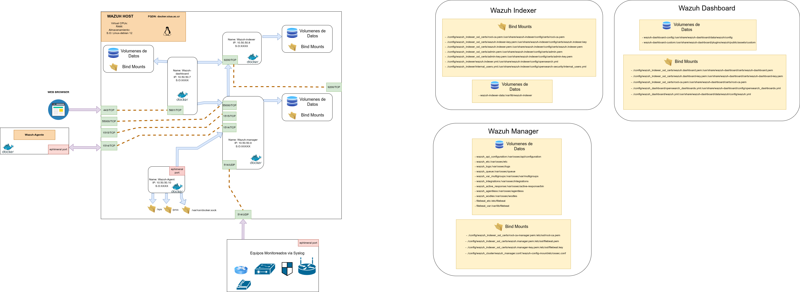
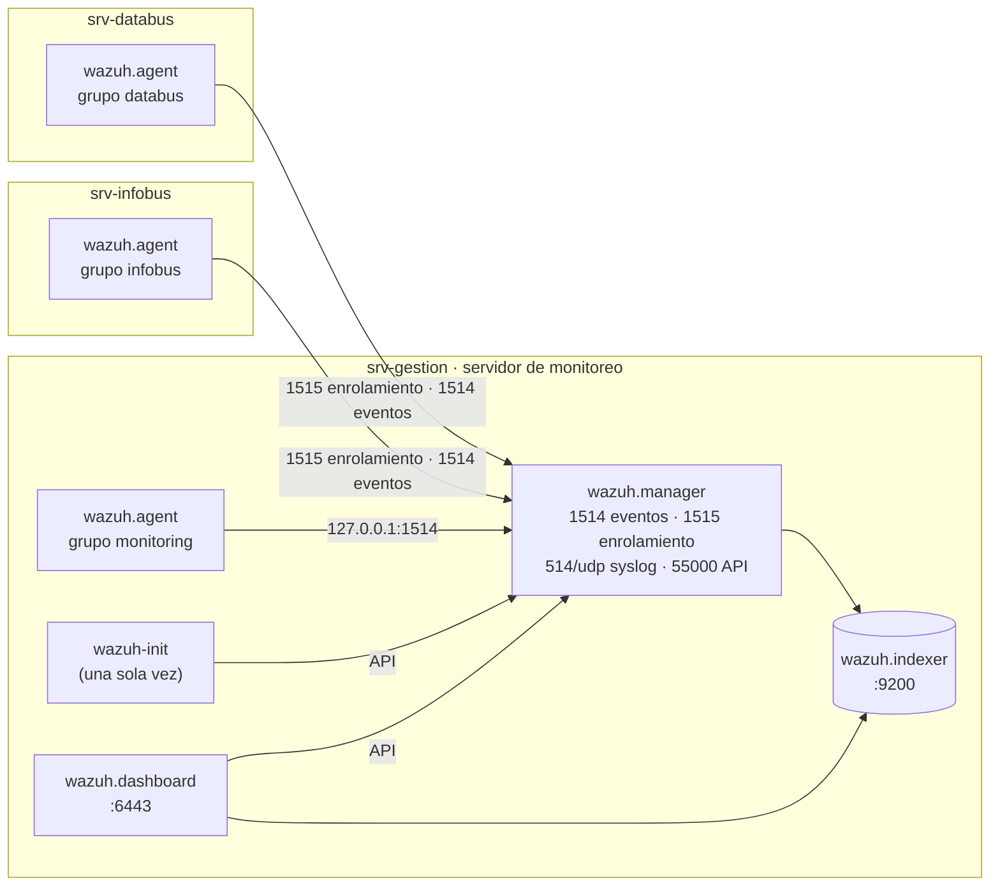
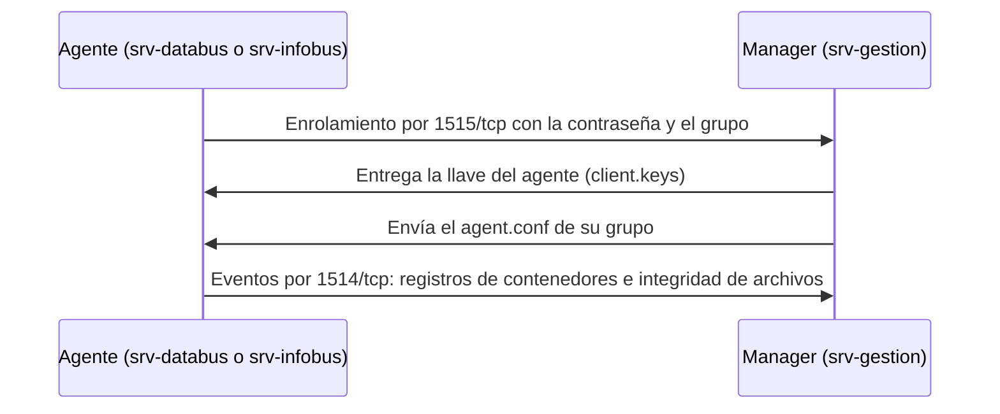

# Wazuh · seguridad de databus e infobus

[English](README.md) · **Español**


Despliegue con Docker Compose de Wazuh (single-node) para vigilar la seguridad de [databus](https://github.com/simovilab/databus), [infobus](https://github.com/simovilab/infobus) y del propio sistema de monitoreo. El repositorio trae dos modos:

- **Servidor (`server`):** Wazuh Indexer, Wazuh Manager y Wazuh Dashboard. Incluye el contenedor `wazuh-init`, que crea los grupos de agentes, su configuración y las reglas del proyecto por API, y un agente local en el grupo `monitoring`.
- **Agente (`agent`):** un agente de Wazuh en Docker en cada servidor de aplicación. Se enrola solo en su grupo (`databus` o `infobus`) con una contraseña de enrolamiento. Lee los registros de los contenedores y vigila la integridad de los archivos del despliegue.



## Arquitectura

| Servicio | Dónde | Función | Tecnología |
| --- | --- | --- | --- |
| **wazuh.indexer** | Servidor | Guarda y busca las alertas y los eventos | Wazuh Indexer 4.14.5 (OpenSearch) |
| **wazuh.manager** | Servidor | Recibe los eventos de los agentes, aplica las reglas y dispara la respuesta activa | Wazuh Manager 4.14.5 |
| **wazuh.dashboard** | Servidor | Interfaz web | Wazuh Dashboard 4.14.5 |
| **wazuh-init** | Servidor | Crea grupos, configuración por grupo y reglas por API. Corre una vez y termina | alpine/curl + bash + jq |
| **wazuh.agent** | Servidor | Agente local en el grupo `monitoring`, con red del host para que la respuesta activa bloquee en el firewall real | Wazuh Agent 4.14.5 |
| **wazuh.agent** | Cada servidor de aplicación | Agente en el grupo `databus` o `infobus`, con red del host por la misma razón | Wazuh Agent 4.14.5 |



## Servidor

El servidor va en la máquina de monitoreo (srv-gestion), junto al servidor de Zabbix. Se levanta con [`docker-compose.yml`](docker-compose.yml).

### Quick start

```bash
git clone -b wazuh-fase-4 https://github.com/rsol9000-01/wazuh.git /home/wazuh
cd /home/wazuh
cp .env.example .env     # reemplazar todos los "CAMBIAR" (ver abajo)
sudo ./scripts/wazuh-dev.sh server
```

La interfaz queda en `https://<servidor>:6443`, con el usuario `MY_USERNAME` y la contraseña `MY_PASSWORD` del `.env`. El certificado es autofirmado, así que el navegador muestra una advertencia la primera vez.

### How to

#### 1. Requisitos

- Linux con Docker Engine y Docker Compose v2. El grupo `docker` tiene que existir.
- Ejecutar el script como **root** (`sudo`). El script hace tres cosas que lo requieren:
  - Sube `vm.max_map_count` a 262144, que el indexer necesita, y lo deja fijo en `/etc/sysctl.conf`.
  - Instala `rsyslog` si no existe `/var/log/auth.log`, para que lleguen los eventos de SSH.
  - Instala `curl` si falta.
- Memoria suficiente para el indexer, que arranca con 1 GB de heap (`OPENSEARCH_JAVA_OPTS`).
- El reloj sincronizado por NTP, con el mismo servidor NTP en srv-gestion, srv-databus y srv-infobus. Ver [Sincronizar el reloj](#sincronizar-el-reloj).
- Puertos abiertos en el firewall del servidor:

| Puerto | Uso |
| --- | --- |
| `1514/tcp` | Eventos de los agentes |
| `1515/tcp` | Enrolamiento de agentes |
| `514/udp` | Syslog |
| `55000/tcp` | API del manager |
| `9200/tcp` | API del indexer |
| `6443/tcp` | Interfaz web (HTTPS) |

#### Sincronizar el reloj

Aplicar esto en srv-gestion, srv-databus y srv-infobus, con **el mismo servidor NTP en los tres**. Las alertas, los bloqueos y los tiempos de detección se comparan entre los tres servidores: un desfase de reloj entre ellos vuelve incorrectos esos tiempos. Los contenedores toman la hora del host, así que no hace falta reiniciarlos.

1. Revisar el estado actual:

```bash
timedatectl | grep -E "synchronized|NTP service"
```

2. Editar `/etc/systemd/timesyncd.conf` y definir el servidor NTP en la sección `[Time]`. Usar el gateway de la red u otro servidor NTP que los tres servidores alcancen:

```ini
[Time]
NTP=<IP del servidor NTP>
```

Para usar el gateway de la red sin editar el archivo a mano:

```bash
GW=$(ip route | awk '/^default/ {print $3; exit}')
sudo sed -i "s/^#\?NTP=.*/NTP=$GW/" /etc/systemd/timesyncd.conf
```

3. Activar la sincronización y reiniciar el servicio:

```bash
sudo timedatectl set-ntp true
sudo systemctl restart systemd-timesyncd
```

4. Probarlo después de unos 30 s:

```bash
timedatectl timesync-status | grep -E "Server|Packet count|Offset"
timedatectl | grep -E "synchronized|NTP service"
```

| Resultado | Significado |
| --- | --- |
| `Server` muestra la IP configurada, `Packet count` es mayor que 0, `System clock synchronized: yes` y `NTP service: active` | Sincronizado |
| `Packet count: 0` | El servidor NTP no responde: el firewall bloquea `123/udp` o ese servidor no da hora. Usar otro servidor NTP |

Repetir la prueba en los tres servidores: `Server` tiene que mostrar la misma IP en todos.

#### 2. Configurar el `.env`

Copiar `.env.example` a `.env` y reemplazar todos los `CAMBIAR`. El `.env` está en `.gitignore`: no subirlo nunca al repositorio.

| Variable | Ejemplo | Qué es |
| --- | --- | --- |
| `MY_USERNAME`, `MY_PASSWORD` | `tfgadmin` / *(propia)* | Usuario administrador propio para la interfaz web. El script lo crea o actualiza en el indexer |
| `INDEXER_PASSWORD` | *(propia)* | Contraseña del usuario interno `admin` del indexer. Ver la advertencia de abajo |
| `API_PASSWORD` | *(propia)* | Contraseña del usuario `wazuh-wui` de la API del manager |
| `DASHBOARD_PASSWORD` | *(propia)* | Contraseña del usuario interno `kibanaserver`, con el que el dashboard habla con el indexer |
| `AGENT_AUTH_PASSWORD` | *(propia)* | Contraseña de enrolamiento de agentes. La misma va en el `.env` de cada agente |
| `DATABUS_PATH`, `INFOBUS_PATH` | `/home/databus`, `/home/infobus` | Rutas de databus e infobus **en el host de cada agente**. Se usan para la vigilancia de integridad (FIM) |
| `WAZUH_PATH`, `ZABBIX_PATH` | `/home/wazuh`, `/home/zabbix` | Rutas de este repositorio y del de Zabbix en el servidor. El agente local vigila su integridad |
| `TZ` | `America/Costa_Rica` | Zona horaria |

`API_PASSWORD`, `DASHBOARD_PASSWORD` y `AGENT_AUTH_PASSWORD` tienen que cumplir esto, o el script las rechaza:

- Entre 8 y 64 caracteres.
- Al menos una mayúscula, una minúscula, un número y uno de `. * + ? -`.
- Sin `$`, `|`, `&` ni `\`.

> **Contraseña de `admin` del indexer.** El script actualiza el hash de `MY_USERNAME` y de `kibanaserver` en `config/wazuh_indexer/internal_users.yml`, pero **no** el de `admin`. Ese usuario conserva el hash que trae `internal_users.yml.template`, y `INDEXER_PASSWORD` tiene que ser la contraseña de ese hash. Si no se conoce, definir una propia antes del primer despliegue:
>
> ```bash
> cp config/wazuh_indexer/internal_users.yml.template config/wazuh_indexer/internal_users.yml
> docker run --rm wazuh/wazuh-indexer:4.14.5 \
>   /usr/share/wazuh-indexer/plugins/opensearch-security/tools/hash.sh -p 'MiClaveIndexer.2026'
> ```
>
> Copiar el hash que imprime en la línea `hash:` del usuario `admin` de `internal_users.yml`, y poner esa misma contraseña en `INDEXER_PASSWORD`.

#### 3. Desplegar

```bash
cd /home/wazuh
sudo ./scripts/wazuh-dev.sh server
```

El script hace esto, en orden:

1. Ajusta `vm.max_map_count`, verifica Docker y el grupo `docker`, y prepara `curl` y `rsyslog`.
2. Crea, si no existen, `config/wazuh_indexer/internal_users.yml` y `config/wazuh_dashboard/wazuh.yml` a partir de sus plantillas.
3. Escribe `API_PASSWORD` en `wazuh.yml` y crea o actualiza los hashes de `MY_USERNAME` y `kibanaserver`.
4. Guarda `AGENT_AUTH_PASSWORD` en `config/wazuh_cluster/authd.pass`, que el manager usa para validar el enrolamiento.
5. Genera los certificados autofirmados de los tres componentes en `config/wazuh_indexer_ssl_certs/`.
6. Levanta el stack con `docker compose up -d`.

El arranque completo tarda varios minutos: el dashboard espera a que el indexer y el manager estén sanos.

#### 4. Qué configura `wazuh-init`

`wazuh-init` corre [`scripts/wazuh-manager-conf.sh`](scripts/wazuh-manager-conf.sh) contra la API del manager. Se puede volver a correr sin duplicar nada:

1. Crea los grupos `databus`, `infobus` y `monitoring`.
2. Sube el `agent.conf` de cada grupo: qué registros lee el agente y qué rutas vigila la integridad (ver [Grupos de agentes](#grupos-de-agentes)).
3. Sube `local_rules.xml` con las reglas del proyecto (ver [Reglas del proyecto](#reglas-del-proyecto)) y `local_decoder.xml` con los decoders del proyecto.
4. Valida la configuración y solo si es válida reinicia el manager.

Cuando termina, arranca el agente local, que se enrola en el grupo `monitoring`.

#### 5. Verificar

```bash
docker compose ps                                      # indexer, manager y dashboard en healthy; wazuh-init en exited (0)
docker compose logs wazuh-init | tail -20              # termina con "The manager is ready to accept registrations"
docker exec wazuh.manager /var/ossec/bin/agent_control -l   # agentes enrolados y su estado
```

En la web: **Agents** muestra el agente local en el grupo `monitoring`, en estado *Active*.

#### Cambiar `wazuh_manager.conf` en una instalación existente

El archivo `config/wazuh_cluster/wazuh_manager.conf` se monta en el contenedor. Al arrancar, la imagen lo copia a `/var/ossec/etc/ossec.conf`, pero **solo en el primer arranque**: en la imagen `4.14.5`, los reinicios siguientes no lo vuelven a copiar. Para aplicar un cambio:

```bash
cd /home/wazuh

# 1. Ver qué cambia frente a la configuración en uso
docker cp wazuh.manager:/var/ossec/etc/ossec.conf /tmp/ossec.en-uso.conf
diff /tmp/ossec.en-uso.conf config/wazuh_cluster/wazuh_manager.conf

# 2. Validar el archivo nuevo (no modifica nada)
docker exec wazuh.manager /var/ossec/bin/wazuh-analysisd -t -c /wazuh-config-mount/etc/ossec.conf && echo "config OK"

# 3. Solo si dio "config OK": respaldar, aplicar y reiniciar
docker exec wazuh.manager cp /var/ossec/etc/ossec.conf /var/ossec/etc/ossec.conf.bak
docker exec wazuh.manager cp /wazuh-config-mount/etc/ossec.conf /var/ossec/etc/ossec.conf
docker exec wazuh.manager /var/ossec/bin/wazuh-control restart

# 4. Confirmar que los agentes se reconectan
docker exec wazuh.manager /var/ossec/bin/agent_control -l
```

Para revertir, copiar `ossec.conf.bak` sobre `ossec.conf` y reiniciar con `wazuh-control restart`. `docker compose restart wazuh.manager` **no** aplica el cambio. Los cambios de grupos, `agent.conf` o reglas sí los aplica `wazuh-init`:

```bash
docker compose up -d wazuh-init
```

#### Operaciones comunes

```bash
docker compose ps
docker compose logs -f wazuh.manager
docker compose restart wazuh.dashboard
docker exec wazuh.manager /var/ossec/bin/agent_control -l
docker compose down        # detiene el stack; los volúmenes se conservan
```

`docker compose down -v` borra los volúmenes: agentes enrolados, llaves y alertas. No usarlo salvo para empezar de cero.

## Agente

El agente va en cada servidor de aplicación: srv-databus y srv-infobus. Se levanta con [`agent/docker-compose-agent.yml`](agent/docker-compose-agent.yml).

### Quick start

```bash
git clone -b wazuh-fase-4 https://github.com/rsol9000-01/wazuh.git /home/wazuh
cd /home/wazuh
cp .env.example .env     # completar las 4 primeras variables (ver abajo)
sudo ./scripts/wazuh-dev.sh agent
```

En uno o dos minutos el agente aparece en la interfaz, en **Agents**, dentro de su grupo.

### How to

#### 1. Requisitos

- El servidor ya desplegado: `wazuh-init` tiene que haber creado los grupos.
- Salida hacia el servidor por `1514/tcp` y `1515/tcp`.
- Docker Engine con Compose v2 y el grupo `docker`. Ejecutar el script como **root** (`sudo`), porque instala `rsyslog` si hace falta.
- La aplicación desplegada en la ruta que se va a declarar en `PROJECT_PATH`.
- El reloj sincronizado con el mismo servidor NTP que el servidor. Ver [Sincronizar el reloj](#sincronizar-el-reloj).

#### 2. Configurar el `.env`

En modo agente solo hay que completar las primeras variables. El resto se deja como viene en `.env.example`.

| Variable | srv-databus | srv-infobus | Qué es |
| --- | --- | --- | --- |
| `REMOTE_AGENT_MANAGER_SERVER` | `wazuh.example.com` | `wazuh.example.com` | Nombre o IP del servidor Wazuh |
| `AGENT_AUTH_PASSWORD` | *(la del servidor)* | *(la del servidor)* | Contraseña de enrolamiento. Tiene que ser **la misma** del `.env` del servidor |
| `REMOTE_AGENT_GROUP` | `databus` | `infobus` | Grupo en el que se enrola el agente |
| `PROJECT_PATH` | `/home/databus` | `/home/infobus` | Ruta de la aplicación en este host. Tiene que coincidir con `DATABUS_PATH` o `INFOBUS_PATH` del servidor |

El nombre del agente es el nombre completo del host (`hostname -f`), porque `LOCAL_AGENT_HOSTNAME=localhost` se reemplaza por él.

#### 3. Desplegar

```bash
cd /home/wazuh
sudo ./scripts/wazuh-dev.sh agent
```

El script verifica Docker, prepara `rsyslog`, guarda `AGENT_AUTH_PASSWORD` en `config/wazuh_cluster/authd.pass` y levanta el agente. Al arrancar, el agente toma su configuración base de [`agent/conf/ossec.conf`](agent/conf/ossec.conf). Después pone en ella la dirección del manager y el grupo, y se enrola con la contraseña.

#### 4. Qué pasa al arrancar



La llave queda guardada en el volumen `wazuh_agent_etc`. En los reinicios siguientes, el agente no vuelve a enrolarse.

#### 5. Verificar

```bash
docker compose -f agent/docker-compose-agent.yml --env-file .env ps
docker logs --tail 30 wazuh.agent      # "Enrollment group" y la conexión con el manager
```

En el servidor:

```bash
docker exec wazuh.manager /var/ossec/bin/agent_control -l
```

#### Operaciones comunes

```bash
docker compose -f agent/docker-compose-agent.yml --env-file .env ps
docker compose -f agent/docker-compose-agent.yml --env-file .env logs -f
docker compose -f agent/docker-compose-agent.yml --env-file .env restart
docker compose -f agent/docker-compose-agent.yml --env-file .env down
```

Para volver a enrolar un agente (por ejemplo, si se borró en el servidor), detenerlo, borrar su volumen y volver a desplegarlo:

```bash
docker compose -f agent/docker-compose-agent.yml --env-file .env down
docker volume ls | grep wazuh_agent_etc        # identificar el volumen del agente
docker volume rm <volumen>
sudo ./scripts/wazuh-dev.sh agent
```

## Referencia

### Grupos de agentes

| Grupo | Host | Registros que lee | Integridad de archivos (FIM, en tiempo real) |
| --- | --- | --- | --- |
| `databus` | srv-databus | `/var/log/auth.log` (SSH, con IP de origen), access log de Traefik y registros JSON de todos los contenedores | `DATABUS_PATH` y el volumen `databus_feed_files` (GTFS publicado). Sin diferencias de `.env` y `.env.prod`; ignora `.git`, `*.log`, `*.tmp` y `__pycache__` |
| `infobus` | srv-infobus | `/var/log/auth.log` (SSH, con IP de origen), access log de Traefik y registros JSON de todos los contenedores | `INFOBUS_PATH`. Sin diferencias de `.env` y `.env.prod`; ignora `.git`, `*.log`, `*.tmp` y `__pycache__` |
| `monitoring` | srv-gestion | `/var/log/auth.log` (SSH, con IP de origen), access log de Traefik y registros JSON de todos los contenedores | `WAZUH_PATH` y `ZABBIX_PATH`. Sin diferencias de los `.env` ni de `authd.pass`; ignora `.git` y los certificados |

"Sin diferencias" quiere decir que Wazuh avisa que el archivo cambió, pero no muestra el contenido, para no exponer credenciales en las alertas.

Además, todos los agentes vigilan los archivos de sistema del servidor, desde `agent/conf/ossec.conf`: `/etc`, `/usr/bin` y `/usr/sbin` en tiempo real y `/boot` cada 12 horas. El agente corre en Docker, así que los lee bajo `/host` (la raíz del servidor, montada en solo lectura) y las alertas muestran la ruta con ese prefijo, por ejemplo `/host/etc/passwd`. Sin el prefijo, FIM vigilaría la imagen del agente y no el servidor.

### Reglas del proyecto

Están en el rango reservado para reglas locales (100100 en adelante). Las descripciones son las que muestra Wazuh.

| Regla | Nivel | Descripción en Wazuh | Qué detecta |
| --- | --- | --- | --- |
| 100100 | 0 | Docker container log line | Base: cualquier línea de registro de un contenedor. No genera alerta |
| 100101 | 10 | databus: GTFS Schedule import failed | Falló la importación del GTFS en databus |
| 100102 | 8 | Request rejected by ALLOWED_HOSTS | Django rechazó una petición por el encabezado Host |
| 100103 | 12 | Host name scan: 8 requests rejected within 120 s | 8 rechazos por Host en 120 s: escaneo de nombres |
| 100104 | 7 | Django 5xx response | Error 5xx en Django |
| 100105 | 3 | 404 response for a nonexistent route | Respuesta 404 |
| 100106 | 10 | Burst of 404 responses: route enumeration | 20 respuestas 404 en 60 s: enumeración de rutas |
| 100107 | 9 | Redis authentication failed | Falló la autenticación contra Redis |
| 100108 | 3 | infobus: failed to process an update event | infobus no pudo procesar un evento de actualización |
| 100110 | 7 | infobus: event retried without limit and without dead-letter handling | 5 fallos en 300 s: reintentos sin límite |
| 100111 | 5 | infobus: malformed update event sent to the dead-letter queue | Evento mal formado enviado a la cola de descarte |
| 100112 | 9 | infobus: producer is continuously sending malformed events | 10 eventos mal formados en 600 s |
| 100109 | 6 | databus: code cloned from GitHub during a cold start | databus clonó código de GitHub al arrancar |
| 100120 | 12 | Deployment configuration or secrets changed | Cambió un `.env` o `compose.prod.yml` |
| 100121 | 10 | databus: published GTFS Schedule changed | Cambió el GTFS que publica databus |
| 100122 | 12 | Docker socket changed | Cambió el socket de Docker |
| 100130 | 0 | Traefik: request in the access log | Base: cualquier petición a Traefik (`/home/traefik/logs/access.log`). No genera alerta |
| 100131 | 5 | Traefik: access denied (…) | Una respuesta 401 o 403 |
| 100132 | 10 | Traefik: brute force, 20 denied requests (401/403) in 60 s | 20 × 100131 desde la misma IP de cliente en 60 s |
| 100133 | 3 | Traefik: 404 for … | Una respuesta 404 |
| 100134 | 10 | Traefik: route scan, 50 different nonexistent paths in 60 s | 50 × 100133 desde la misma IP de cliente, cada una en una ruta distinta, en 60 s |
| 100135 | 10 | Traefik: flooding, 3000 requests in 30 s (100 req/s) | 3000 peticiones desde la misma IP de cliente en 30 s |
| 100136 | 7 | Traefik: missing route requested 50 times in 60 s | 50 × 100133 en el mismo host y ruta, desde cualquier cliente, en 60 s. Solo alerta: un cliente con una URL vieja, no un ataque. Como máximo una alerta por minuto |
| 100137 | 5 | Traefik: failed Django admin login | Un `POST` a `/admin/login/` que responde 200. Ante un ingreso fallido Django vuelve a mostrar el formulario (uno correcto responde 302) y no registra el fallo |
| 100138 | 10 | Traefik: Django admin brute force, 10 failed logins in 120 s | 10 × 100137 desde la misma IP de cliente en 120 s |
| 651 | 3 | Host Blocked by firewall-drop Active Response: *IP* (rule *ID*) | Regla de fábrica de Wazuh, sobrescrita (`overwrite="yes"`) solo para agregar al mensaje la IP bloqueada y la regla que disparó el bloqueo |
| 652 | 3 | Host Unblocked by firewall-drop Active Response: *IP* (rule *ID*) | Igual que 651, para el desbloqueo |

Las reglas 100130–100138 leen el access log de Traefik, que registra la IP del cliente (`ClientHost`). El decoder local `simovilab-traefik` copia esa IP a `srcip`, el campo que usa la respuesta activa para bloquear a un cliente.

### Respuesta activa

| Comando | Reglas | Dónde se ejecuta | Duración |
| --- | --- | --- | --- |
| `firewall-drop` | 5712, 5720 y 5763 (fuerza bruta e intentos fallidos por SSH) | En el agente que generó la alerta (`local`) | 3600 s (1 h) |
| `firewall-drop` | 100132, 100134 y 100138 (fuerza bruta y escaneo de rutas en Traefik, y fuerza bruta al admin de Django) | En el agente que generó la alerta (`local`) | 3600 s (1 h) |

Todos los agentes (srv-databus, srv-infobus y srv-gestion) comparten la red del host y tienen la capacidad `NET_ADMIN`, así que `firewall-drop` escribe en el firewall del host y el bloqueo es real. El manager nunca bloquea 127.0.0.1, los tres servidores del proyecto (`10.20.203.23`, `.24` y `.25`: sondeos de Zabbix y Wazuh, y srv-infobus leyendo el GTFS de srv-databus) ni las redes internas de Docker (`172.16.0.0/12`). La regla 100135 (inundación) solo alerta: varias pantallas detrás de un mismo NAT pueden pasar el umbral sin ser un ataque.

#### Lista de IPs que nunca se bloquean

Las IPs de los tres servidores cambian en cada instalación (laboratorio, producción). Wazuh solo acepta esta lista dentro de `ossec.conf`, en el bloque `<global>`, así que no puede venir del `.env`: hay que editarla en el archivo.

| Qué | Dónde |
| --- | --- |
| Archivo | `config/wazuh_cluster/wazuh_manager.conf`, en srv-gestion |
| Líneas | Entre `===== EDITAR EN CADA INSTALACION` y `===== FIN DE LO QUE SE EDITA`. Para verlas: `grep -n white_list config/wazuh_cluster/wazuh_manager.conf` |
| Formato | Una línea `<white_list>IP</white_list>` por servidor. Acepta redes en notación CIDR, por ejemplo `10.20.203.0/24` |
| No tocar | `127.0.0.1`, `::1`, `localhost` y `172.16.0.0/12` (redes de Docker) |

Después de editar, aplicar el cambio con el procedimiento de [Cambiar `wazuh_manager.conf` en una instalación existente](#cambiar-wazuh_managerconf-en-una-instalación-existente) y comprobar:

```bash
docker exec wazuh.manager grep -n white_list /var/ossec/etc/ossec.conf
```

Si falta la IP de un servidor, una ráfaga de errores entre servidores (por ejemplo, srv-infobus pidiendo un GTFS que ya no existe en srv-databus) puede hacer que uno bloquee al otro durante 1 h.

#### Requisito: la IP del cliente tiene que llegar a Traefik

Las reglas 100132, 100134 y 100138 bloquean la IP que Traefik registra como `ClientHost`: la IP que abrió la conexión con Traefik. El bloqueo solo es correcto si esa IP es la del cliente real.

| Caso | Qué registra Traefik | Resultado |
| --- | --- | --- |
| El firewall delante del servidor reenvía la conexión sin cambiar la IP de origen (solo NAT de destino) | La IP real del cliente | Se bloquea solo al atacante |
| El firewall u otro proxy cambia la IP de origen por la suya (NAT de origen, enmascaramiento o un proxy delante de Traefik) | La IP del firewall o del proxy, la misma para todos los clientes | Ver las consecuencias abajo |

Consecuencias si todos los clientes llegan con la IP del firewall:

- **Se bloquea todo el servicio.** 20 peticiones denegadas en 60 s, sumando las de todos los usuarios (por ejemplo, varias pantallas con un token vencido), disparan la regla 100132. `firewall-drop` bloquea entonces la IP del firewall, y todos los clientes pierden el acceso a ese servidor durante 1 h.
- **No se puede identificar al atacante.** Todas las alertas muestran la misma IP.

Comprobarlo en cada servidor que esté detrás de Traefik. Abrir cualquier página del servicio desde una PC de IP conocida y luego ejecutar en el servidor:

```bash
tail -200 /home/traefik/logs/access.log | python3 -c "import sys,json; print(sorted({json.loads(l)['ClientHost'] for l in sys.stdin}))"
```

La IP de la PC tiene que aparecer en la lista. Si solo aparece la IP del firewall, deshabilitar la respuesta activa de Traefik como se indica abajo.

#### Deshabilitar la respuesta activa de Traefik

Usar esto cuando no sea posible hacer llegar la IP real del cliente a Traefik. Las reglas 100132, 100134 y 100138 siguen generando alertas; solo se detiene el bloqueo automático. El bloqueo de SSH (reglas 5712, 5720 y 5763) está en otro bloque y no se ve afectado.

1. En srv-gestion, abrir `config/wazuh_cluster/wazuh_manager.conf`.
2. Buscar el bloque `<active-response>` que contiene `<rules_id>100132,100134,100138</rules_id>`.
3. En ese bloque, cambiar `<disabled>no</disabled>` por `<disabled>yes</disabled>`.
4. Aplicar el cambio con el procedimiento de [Cambiar `wazuh_manager.conf` en una instalación existente](#cambiar-wazuh_managerconf-en-una-instalación-existente).
5. Comprobar que el manager lo cargó:

```bash
docker exec wazuh.manager grep -n -B2 -A3 "100132,100134" /var/ossec/etc/ossec.conf
```

La salida tiene que mostrar `<disabled>yes</disabled>`. Para volver a habilitarla, repetir los pasos con `no`.

### Volúmenes

| Volumen | Contenedor | Contenido |
| --- | --- | --- |
| `wazuh-indexer-data` | wazuh.indexer | Índices de alertas y eventos |
| `wazuh_etc`, `wazuh_api_configuration` | wazuh.manager | Configuración del manager y de la API, llaves de los agentes |
| `wazuh_logs`, `wazuh_queue` | wazuh.manager | Registros y colas del manager |
| `wazuh_var_multigroups`, `wazuh_integrations`, `wazuh_active_response`, `wazuh_agentless`, `wazuh_wodles` | wazuh.manager | Datos de módulos del manager |
| `filebeat_etc`, `filebeat_var` | wazuh.manager | Envío de alertas al indexer |
| `wazuh-dashboard-config`, `wazuh-dashboard-custom` | wazuh.dashboard | Configuración y recursos del dashboard |
| `wazuh_agent_etc` | wazuh.agent | Configuración y llave del agente |

### Evaluación de configuración (CIS)

Los agentes corren en Docker, así que las políticas SCA oficiales evaluarían la imagen del agente en lugar del servidor. Al arrancar, `agent/sca_host.py` arma una copia "del host" de la política oficial del sistema operativo del host, tomada de la misma versión de Wazuh (se descarga al construir la imagen del agente):

| En la política oficial | En la política del host |
| --- | --- |
| Controles `f:` y `d:` (archivos y carpetas) | Se leen bajo `/host`, la raíz del host montada en solo lectura |
| Controles `c:` (comandos como `systemctl`, `sshd -T` o `dpkg-query`) | Corren en los namespaces del host con `nsenter -t 1 -m -u -i -n -p --` |
| Id y nombre de la política | Sufijo `_host` y ` (host)` |

La política se elige con `ID` y `VERSION_ID` de `/host/etc/os-release` (Ubuntu, Debian, RHEL, Rocky, AlmaLinux, Oracle Linux, CentOS, Amazon Linux y SLES) y solo se arma esa. El bloque `requirements` de las políticas oficiales no sirve para elegir: varias solo revisan que exista un archivo, así que las políticas de Debian 7 a 10 también pasarían en Ubuntu. Si ninguna política coincide con el host, se usa la política de Linux independiente de la distribución. Las políticas de la imagen del agente quedan desactivadas. Si falta `/host` o faltan las políticas, SCA se apaga en lugar de informar sobre el contenedor. No se usa `chroot`: desde un chroot `systemctl` no llega a systemd.

El SCA propio del manager (agente 000) está apagado, porque evaluaría el contenedor del manager. srv-gestion lo evalúa su propio agente.

El servicio del agente necesita, en `agent/docker-compose-agent.yml` y en `docker-compose.yml`: `pid: host`, `SYS_ADMIN` y `SYS_PTRACE` en `cap_add`, `apparmor=unconfined` en `security_opt` y el volumen `/:/host:ro`. El namespace de PID del host es obligatorio: sin él, `systemctl` y `ps` fallan dentro de los namespaces del host.

**Usar `pid: host` solo con la imagen construida desde `agent/Dockerfile`.** La imagen oficial del agente usa s6-overlay, que al detener el contenedor mata todos los procesos que ve (`s6-nuke`). Con `pid: host` son todos los procesos del servidor: sesiones SSH, Docker y los contenedores de la aplicación. `agent/Dockerfile` quita ese paso y la construcción falla si sigue ahí.

Comprobarlo en cada servidor después de arrancar el agente:

```bash
docker logs wazuh.agent 2>&1 | grep "SCA:"
docker exec wazuh.agent ls /var/ossec/etc/sca-host
```

El registro tiene que mostrar `SCA: host ubuntu 24.04 -> ubuntu/cis_ubuntu24-04.yml -> …` (con el sistema operativo del host) y `SCA: politicas del host activadas.` (o `SCA: host policies enabled.` con el script en inglés). La carpeta tiene que tener un solo archivo. En el dashboard (☰ → **Configuration Assessment** → agente), el nombre de la política tiene que terminar en `(host)`, por ejemplo `CIS Ubuntu Linux 24.04 LTS Benchmark v1.0.0. (host)`.

## Notas de seguridad

- **Credenciales:** van solo en `.env`, `config/wazuh_cluster/authd.pass`, `config/wazuh_indexer/internal_users.yml`, `config/wazuh_dashboard/wazuh.yml` y `config/wazuh_indexer_ssl_certs/`, que están en `.gitignore`. Reemplazar todos los `CAMBIAR` antes de desplegar.
- **Vista del host para SCA:** los agentes reciben `pid: host`, `SYS_ADMIN`, `SYS_PTRACE`, AppArmor sin confinar y la raíz del host en solo lectura en `/host`. Pueden leer todo el host y correr comandos en sus namespaces. El riesgo real no crece, porque el socket de Docker ya da un acceso equivalente, pero un agente comprometido puede hacer más de forma directa. Si se quitan esas líneas, SCA se apaga solo.
- **Socket de Docker:** los agentes lo montan en modo solo lectura para leer los registros de los contenedores. Eso da mucho acceso al host; la regla 100122 avisa si el socket cambia.
- **Certificados:** son autofirmados, para la comunicación entre el indexer, el manager y el dashboard. Para exponer la interfaz fuera de la red interna, poner delante un proxy con un certificado válido.
- **Firewall:** abrir `1514/tcp` y `1515/tcp` solo para los agentes, y `6443/tcp`, `55000/tcp` y `9200/tcp` solo para la red de administración.
- **Versiones fijas:** todas las imágenes están fijadas en `4.14.5`. Cambiarlas solo a propósito y probarlas antes.

## Documentación

- [`docker-compose.yml`](docker-compose.yml): stack del servidor y agente local.
- [`agent/docker-compose-agent.yml`](agent/docker-compose-agent.yml): agente remoto.
- [`agent/conf/ossec.conf`](agent/conf/ossec.conf): configuración base de los agentes.
- [`config/wazuh_cluster/wazuh_manager.conf`](config/wazuh_cluster/wazuh_manager.conf): configuración del manager.
- [`scripts/wazuh-dev.sh`](scripts/wazuh-dev.sh): despliegue de servidor y agente.
- [`scripts/wazuh-manager-conf.sh`](scripts/wazuh-manager-conf.sh): grupos, `agent.conf` y reglas que carga `wazuh-init`.
- [`scripts/wazuh-agent-conf.sh`](scripts/wazuh-agent-conf.sh): arranque y enrolamiento del agente.
- [`agent/sca_host.py`](agent/sca_host.py): arma las políticas SCA (CIS) del host.
- [`diagramas/`](diagramas/): diagrama de la arquitectura en draw.io, SVG y PNG.