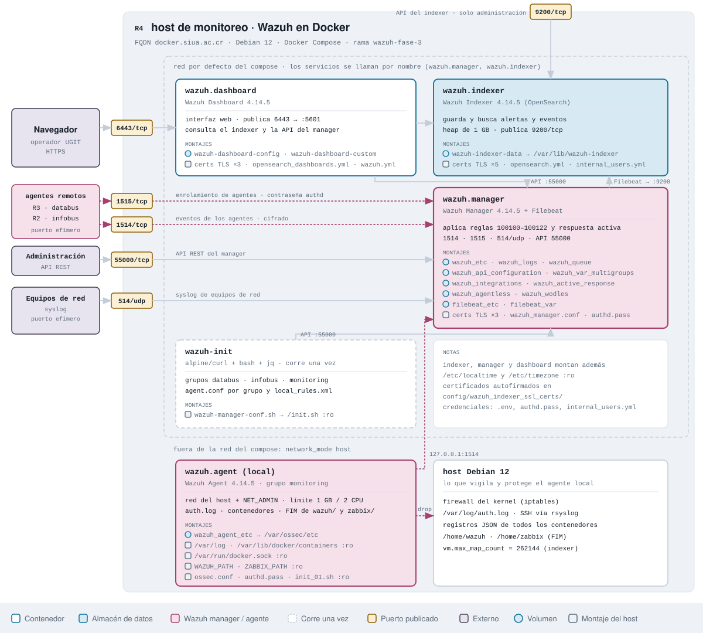
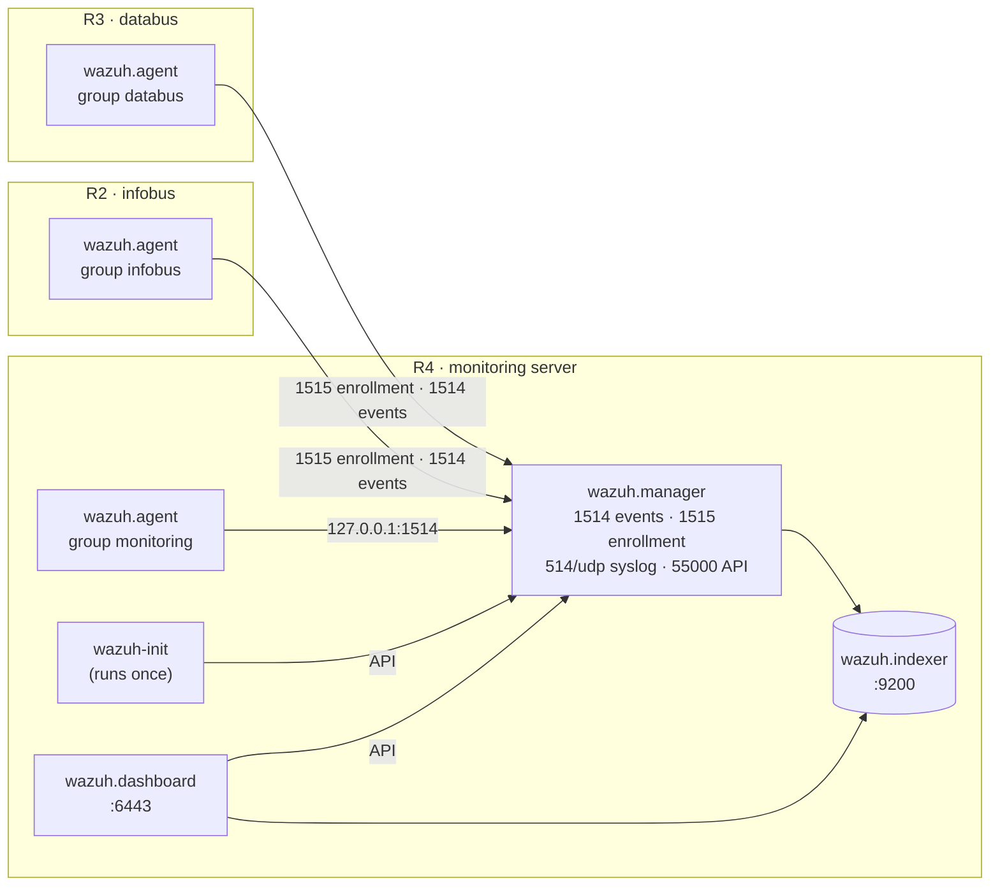
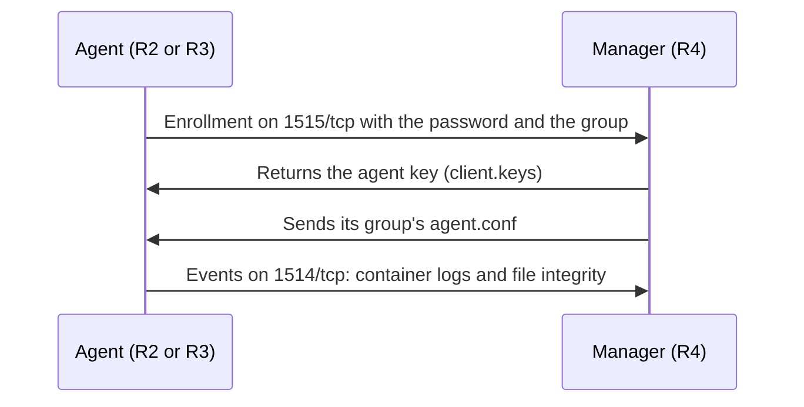

# Wazuh · databus and infobus security

**English** · [Español](README%20es.md)


Docker Compose deployment of Wazuh (single-node) to watch the security of [databus](https://github.com/simovilab/databus), [infobus](https://github.com/simovilab/infobus) and the monitoring system itself. The repository has two modes:

- **Server (`server`):** Wazuh Indexer, Wazuh Manager and Wazuh Dashboard. It includes the `wazuh-init` container, which creates the agent groups, their configuration and the project rules through the API, and a local agent in the `monitoring` group.
- **Agent (`agent`):** a Wazuh agent in Docker on each application server. It enrolls itself in its group (`databus` or `infobus`) with an enrollment password. It reads container logs and watches the integrity of the deployment files.



## Architecture

| Service | Where | Role | Tech |
| --- | --- | --- | --- |
| **wazuh.indexer** | Server | Stores and searches alerts and events | Wazuh Indexer 4.14.5 (OpenSearch) |
| **wazuh.manager** | Server | Receives agent events, applies rules and triggers active response | Wazuh Manager 4.14.5 |
| **wazuh.dashboard** | Server | Web frontend | Wazuh Dashboard 4.14.5 |
| **wazuh-init** | Server | Creates groups, per-group configuration and rules through the API. Runs once and exits | alpine/curl + bash + jq |
| **wazuh.agent** | Server | Local agent in the `monitoring` group, on the host network so active response blocks on the real firewall | Wazuh Agent 4.14.5 |
| **wazuh.agent** | Each application server | Agent in the `databus` or `infobus` group | Wazuh Agent 4.14.5 |



## Server

The server runs on the monitoring machine (R4), next to the Zabbix server. It starts with [`docker-compose.yml`](docker-compose.yml).

### Quick start

```bash
git clone -b wazuh-fase-3 https://github.com/rsol9000-01/wazuh.git /home/wazuh
cd /home/wazuh
cp .env.example .env     # replace every "CAMBIAR" (see below)
sudo ./scripts/wazuh-dev.sh server
```

The frontend is at `https://<server>:6443`, with user `MY_USERNAME` and password `MY_PASSWORD` from `.env`. The certificate is self-signed, so the browser shows a warning the first time.

### How to

#### 1. Prerequisites

- Linux with Docker Engine and Docker Compose v2. The `docker` group must exist.
- Run the script as **root** (`sudo`). The script does three things that need it:
  - Raises `vm.max_map_count` to 262144, which the indexer needs, and makes it persistent in `/etc/sysctl.conf`.
  - Installs `rsyslog` if `/var/log/auth.log` does not exist, so SSH events reach Wazuh.
  - Installs `curl` if it is missing.
- Enough memory for the indexer, which starts with a 1 GB heap (`OPENSEARCH_JAVA_OPTS`).
- Ports open in the server firewall:

| Port | Use |
| --- | --- |
| `1514/tcp` | Agent events |
| `1515/tcp` | Agent enrollment |
| `514/udp` | Syslog |
| `55000/tcp` | Manager API |
| `9200/tcp` | Indexer API |
| `6443/tcp` | Web frontend (HTTPS) |

#### 2. Configure `.env`

Copy `.env.example` to `.env` and replace every `CAMBIAR`. `.env` is in `.gitignore`: never commit it.

| Variable | Example | What it is |
| --- | --- | --- |
| `MY_USERNAME`, `MY_PASSWORD` | `tfgadmin` / *(your own)* | Your administrator user for the frontend. The script creates or updates it in the indexer |
| `INDEXER_PASSWORD` | *(your own)* | Password of the indexer internal `admin` user. See the warning below |
| `API_PASSWORD` | *(your own)* | Password of the manager API `wazuh-wui` user |
| `DASHBOARD_PASSWORD` | *(your own)* | Password of the internal `kibanaserver` user, which the dashboard uses to talk to the indexer |
| `AGENT_AUTH_PASSWORD` | *(your own)* | Agent enrollment password. The same one goes in each agent's `.env` |
| `DATABUS_PATH`, `INFOBUS_PATH` | `/home/databus`, `/home/infobus` | databus and infobus paths **on each agent host**. Used for file integrity monitoring (FIM) |
| `WAZUH_PATH`, `ZABBIX_PATH` | `/home/wazuh`, `/home/zabbix` | Paths of this repository and the Zabbix one on the server. The local agent watches their integrity |
| `TZ` | `America/Costa_Rica` | Time zone |

`API_PASSWORD`, `DASHBOARD_PASSWORD` and `AGENT_AUTH_PASSWORD` must meet these rules, or the script rejects them:

- 8 to 64 characters.
- At least one uppercase letter, one lowercase letter, one digit and one of `. * + ? -`.
- No `$`, `|`, `&` or `\`.

> **Indexer `admin` password.** The script updates the hash of `MY_USERNAME` and `kibanaserver` in `config/wazuh_indexer/internal_users.yml`, but **not** the one of `admin`. That user keeps the hash from `internal_users.yml.template`, and `INDEXER_PASSWORD` must be the password behind that hash. If you do not know it, set your own before the first deployment:
>
> ```bash
> cp config/wazuh_indexer/internal_users.yml.template config/wazuh_indexer/internal_users.yml
> docker run --rm wazuh/wazuh-indexer:4.14.5 \
>   /usr/share/wazuh-indexer/plugins/opensearch-security/tools/hash.sh -p 'MyIndexerPass.2026'
> ```
>
> Copy the printed hash into the `hash:` line of the `admin` user in `internal_users.yml`, and put the same password in `INDEXER_PASSWORD`.

#### 3. Deploy

```bash
cd /home/wazuh
sudo ./scripts/wazuh-dev.sh server
```

The script does this, in order:

1. Sets `vm.max_map_count`, checks Docker and the `docker` group, and prepares `curl` and `rsyslog`.
2. Creates `config/wazuh_indexer/internal_users.yml` and `config/wazuh_dashboard/wazuh.yml` from their templates, if they do not exist.
3. Writes `API_PASSWORD` into `wazuh.yml` and creates or updates the `MY_USERNAME` and `kibanaserver` hashes.
4. Saves `AGENT_AUTH_PASSWORD` to `config/wazuh_cluster/authd.pass`, which the manager uses to validate enrollment.
5. Generates self-signed certificates for the three components in `config/wazuh_indexer_ssl_certs/`.
6. Starts the stack with `docker compose up -d`.

A full start takes several minutes: the dashboard waits until the indexer and the manager are healthy.

#### 4. What `wazuh-init` configures

`wazuh-init` runs [`scripts/wazuh-manager-conf.sh`](scripts/wazuh-manager-conf.sh) against the manager API. It can run again without duplicating anything:

1. Creates the `databus`, `infobus` and `monitoring` groups.
2. Uploads each group's `agent.conf`: which logs the agent reads and which paths integrity monitoring watches (see [Agent groups](#agent-groups)).
3. Uploads `local_rules.xml` with the project rules (see [Project rules](#project-rules)).
4. Validates the configuration and restarts the manager only if it is valid.

When it ends, the local agent starts and enrolls in the `monitoring` group.

#### 5. Verify

```bash
docker compose ps                                      # indexer, manager and dashboard healthy; wazuh-init exited (0)
docker compose logs wazuh-init | tail -20              # ends with "The manager is ready to accept registrations"
docker exec wazuh.manager /var/ossec/bin/agent_control -l   # enrolled agents and their status
```

In the frontend: **Agents** shows the local agent in the `monitoring` group, in *Active* state.

#### Change `wazuh_manager.conf` on an existing installation

`config/wazuh_cluster/wazuh_manager.conf` is mounted into the container. At startup the image copies it to `/var/ossec/etc/ossec.conf`, but **only on the first start**: with the `4.14.5` image, later restarts do not copy it again. To apply a change:

```bash
cd /home/wazuh

# 1. See what changes compared with the configuration in use
docker cp wazuh.manager:/var/ossec/etc/ossec.conf /tmp/ossec.in-use.conf
diff /tmp/ossec.in-use.conf config/wazuh_cluster/wazuh_manager.conf

# 2. Validate the new file (changes nothing)
docker exec wazuh.manager /var/ossec/bin/wazuh-analysisd -t -c /wazuh-config-mount/etc/ossec.conf && echo "config OK"

# 3. Only if it printed "config OK": back up, apply and restart
docker exec wazuh.manager cp /var/ossec/etc/ossec.conf /var/ossec/etc/ossec.conf.bak
docker exec wazuh.manager cp /wazuh-config-mount/etc/ossec.conf /var/ossec/etc/ossec.conf
docker exec wazuh.manager /var/ossec/bin/wazuh-control restart

# 4. Confirm the agents reconnect
docker exec wazuh.manager /var/ossec/bin/agent_control -l
```

To revert, copy `ossec.conf.bak` over `ossec.conf` and restart with `wazuh-control restart`. `docker compose restart wazuh.manager` does **not** apply the change. Changes to groups, `agent.conf` or rules are applied by `wazuh-init`:

```bash
docker compose up -d wazuh-init
```

#### Common operations

```bash
docker compose ps
docker compose logs -f wazuh.manager
docker compose restart wazuh.dashboard
docker exec wazuh.manager /var/ossec/bin/agent_control -l
docker compose down        # stops the stack; volumes are kept
```

`docker compose down -v` deletes the volumes: enrolled agents, keys and alerts. Do not use it unless you want to start from scratch.

## Agent

The agent runs on each application server: R3 with databus and R2 with infobus. It starts with [`agent/docker-compose-agent.yml`](agent/docker-compose-agent.yml).

### Quick start

```bash
git clone -b wazuh-fase-3 https://github.com/rsol9000-01/wazuh.git /home/wazuh
cd /home/wazuh
cp .env.example .env     # fill in the first 4 variables (see below)
sudo ./scripts/wazuh-dev.sh agent
```

Within a minute or two the agent shows up in the frontend under **Agents**, in its group.

### How to

#### 1. Prerequisites

- The server already deployed: `wazuh-init` must have created the groups.
- Outbound access to the server on `1514/tcp` and `1515/tcp`.
- Docker Engine with Compose v2 and the `docker` group. Run the script as **root** (`sudo`), because it installs `rsyslog` when needed.
- The application deployed at the path you will declare in `PROJECT_PATH`.

#### 2. Configure `.env`

In agent mode only the first variables need to be filled in. Leave the rest as it comes in `.env.example`.

| Variable | databus (R3) | infobus (R2) | What it is |
| --- | --- | --- | --- |
| `REMOTE_AGENT_MANAGER_SERVER` | `wazuh.example.com` | `wazuh.example.com` | Wazuh server name or IP |
| `AGENT_AUTH_PASSWORD` | *(the server's)* | *(the server's)* | Enrollment password. Must be **the same** as in the server `.env` |
| `REMOTE_AGENT_GROUP` | `databus` | `infobus` | Group the agent enrolls in |
| `PROJECT_PATH` | `/home/databus` | `/home/infobus` | Application path on this host. Must match the server's `DATABUS_PATH` or `INFOBUS_PATH` |

The agent name is the host's full name (`hostname -f`), because `LOCAL_AGENT_HOSTNAME=localhost` is replaced with it.

#### 3. Deploy

```bash
cd /home/wazuh
sudo ./scripts/wazuh-dev.sh agent
```

The script checks Docker, prepares `rsyslog`, saves `AGENT_AUTH_PASSWORD` to `config/wazuh_cluster/authd.pass` and starts the agent. At startup the agent takes its base configuration from [`agent/conf/ossec.conf`](agent/conf/ossec.conf). It then sets the manager address and the group in it, and enrolls with the password.

#### 4. What happens at startup



The key is stored in the `wazuh_agent_etc` volume. On later restarts the agent does not enroll again.

#### 5. Verify

```bash
docker compose -f agent/docker-compose-agent.yml --env-file .env ps
docker logs --tail 30 wazuh.agent      # "Enrollment group" and the connection to the manager
```

On the server:

```bash
docker exec wazuh.manager /var/ossec/bin/agent_control -l
```

#### Common operations

```bash
docker compose -f agent/docker-compose-agent.yml --env-file .env ps
docker compose -f agent/docker-compose-agent.yml --env-file .env logs -f
docker compose -f agent/docker-compose-agent.yml --env-file .env restart
docker compose -f agent/docker-compose-agent.yml --env-file .env down
```

To enroll an agent again (for example, if you deleted it on the server), stop it, delete its volume and deploy it again:

```bash
docker compose -f agent/docker-compose-agent.yml --env-file .env down
docker volume ls | grep wazuh_agent_etc        # find the agent volume
docker volume rm <volume>
sudo ./scripts/wazuh-dev.sh agent
```

## Reference

### Agent groups

| Group | Host | Logs it reads | File integrity (FIM, real time) |
| --- | --- | --- | --- |
| `databus` | R3 | JSON logs of every container | `DATABUS_PATH` and the `databus_feed_files` volume (published GTFS). No diffs for `.env` and `.env.prod`; ignores `.git`, `*.log`, `*.tmp` and `__pycache__` |
| `infobus` | R2 | JSON logs of every container | `INFOBUS_PATH`. No diffs for `.env` and `.env.prod`; ignores `.git`, `*.log`, `*.tmp` and `__pycache__` |
| `monitoring` | R4 | `/var/log/auth.log` (SSH, with source IP) and JSON logs of every container | `WAZUH_PATH` and `ZABBIX_PATH`. No diffs for the `.env` files or `authd.pass`; ignores `.git` and the certificates |

"No diffs" means Wazuh reports that the file changed but does not show its content, so credentials never appear in alerts.

### Project rules

They use the range reserved for local rules (100100 and up).

| Rule | Level | Description in Wazuh | What it detects |
| --- | --- | --- | --- |
| 100100 | 0 | Docker container log line | Base: any container log line. Raises no alert |
| 100101 | 10 | databus: GTFS Schedule import failed | The GTFS import failed in databus |
| 100102 | 8 | Request rejected by ALLOWED_HOSTS | Django rejected a request because of its Host header |
| 100103 | 12 | Host name scan: 8 requests rejected within 120 s | 8 Host rejections within 120 s: host name scan |
| 100104 | 7 | Django 5xx response | A 5xx error in Django |
| 100105 | 3 | 404 response for a nonexistent route | A 404 response |
| 100106 | 10 | Burst of 404 responses: route enumeration | 20 404 responses within 60 s: route enumeration |
| 100107 | 9 | Redis authentication failed | Authentication against Redis failed |
| 100108 | 3 | infobus: failed to process an update event | infobus could not process an update event |
| 100110 | 7 | infobus: event retried without limit and without dead-letter handling | 5 failures within 300 s: unbounded retries |
| 100111 | 5 | infobus: malformed update event sent to the dead-letter queue | A malformed event went to the dead-letter queue |
| 100112 | 9 | infobus: producer is continuously sending malformed events | 10 malformed events within 600 s |
| 100109 | 6 | databus: code cloned from GitHub during a cold start | databus cloned code from GitHub at startup |
| 100120 | 12 | Deployment configuration or secrets changed | A `.env` or `compose.prod.yml` changed |
| 100121 | 10 | databus: published GTFS Schedule changed | The GTFS published by databus changed |
| 100122 | 12 | Docker socket changed | The Docker socket changed |

### Active response

| Command | Rules | Where it runs | Duration |
| --- | --- | --- | --- |
| `firewall-drop` | 5712, 5720 and 5763 (SSH brute force and failed logins) | On the agent that raised the alert (`local`) | 180 s |

The block is real only on the R4 local agent: it shares the host network and has the `NET_ADMIN` capability. On the R2 and R3 agents the block stays inside the container and does not protect the host.

### Volumes

| Volume | Container | Content |
| --- | --- | --- |
| `wazuh-indexer-data` | wazuh.indexer | Alert and event indices |
| `wazuh_etc`, `wazuh_api_configuration` | wazuh.manager | Manager and API configuration, agent keys |
| `wazuh_logs`, `wazuh_queue` | wazuh.manager | Manager logs and queues |
| `wazuh_var_multigroups`, `wazuh_integrations`, `wazuh_active_response`, `wazuh_agentless`, `wazuh_wodles` | wazuh.manager | Manager module data |
| `filebeat_etc`, `filebeat_var` | wazuh.manager | Alert shipping to the indexer |
| `wazuh-dashboard-config`, `wazuh-dashboard-custom` | wazuh.dashboard | Dashboard configuration and assets |
| `wazuh_agent_etc` | wazuh.agent | Agent configuration and key |

## Security notes

- **Credentials:** they go only in `.env`, `config/wazuh_cluster/authd.pass`, `config/wazuh_indexer/internal_users.yml`, `config/wazuh_dashboard/wazuh.yml` and `config/wazuh_indexer_ssl_certs/`, which are in `.gitignore`. Replace every `CAMBIAR` before deploying.
- **Docker socket:** agents mount it read-only to read container logs. That grants significant host access; rule 100122 alerts if the socket changes.
- **Certificates:** they are self-signed, for communication between the indexer, the manager and the dashboard. To expose the frontend outside the internal network, put a proxy with a valid certificate in front.
- **Firewall:** open `1514/tcp` and `1515/tcp` only to the agents, and `6443/tcp`, `55000/tcp` and `9200/tcp` only to the management network.
- **Pinned versions:** every image is pinned to `4.14.5`. Change them on purpose and test before.

## Documentation

- [`docker-compose.yml`](docker-compose.yml): server stack and local agent.
- [`agent/docker-compose-agent.yml`](agent/docker-compose-agent.yml): remote agent.
- [`agent/conf/ossec.conf`](agent/conf/ossec.conf): agent base configuration.
- [`config/wazuh_cluster/wazuh_manager.conf`](config/wazuh_cluster/wazuh_manager.conf): manager configuration.
- [`scripts/wazuh-dev.sh`](scripts/wazuh-dev.sh): server and agent deployment.
- [`scripts/wazuh-manager-conf.sh`](scripts/wazuh-manager-conf.sh): groups, `agent.conf` and rules loaded by `wazuh-init`.
- [`scripts/wazuh-agent-conf.sh`](scripts/wazuh-agent-conf.sh): agent startup and enrollment.
- [`diagramas/`](diagramas/): architecture diagram in draw.io, SVG and PNG.
