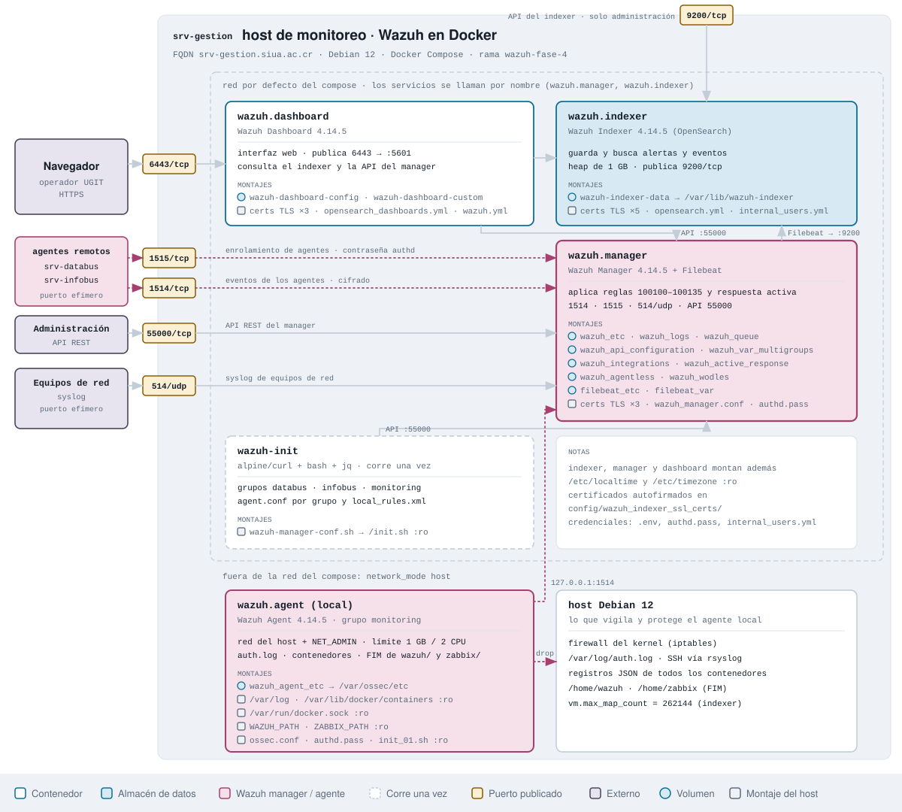
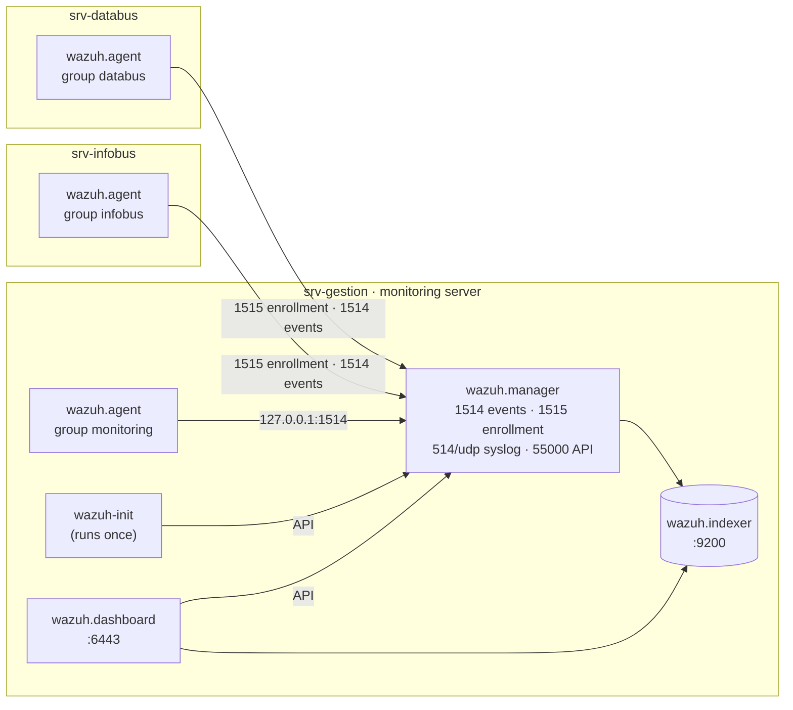
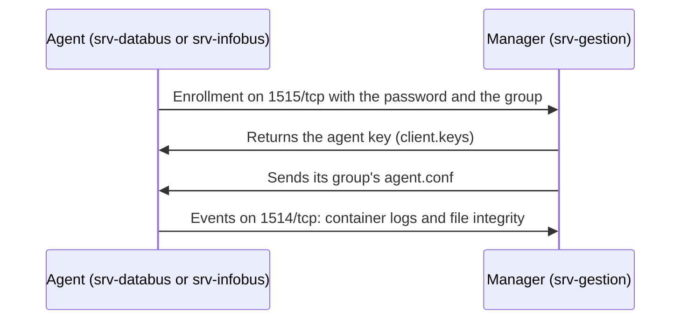

# Wazuh · databus and infobus security

**English** · [Español](README%20es.md)


Docker Compose deployment of Wazuh (single-node) to watch the security of [databus](https://github.com/simovilab/databus), [infobus](https://github.com/simovilab/infobus) and the monitoring system itself. The repository has two modes:

- **Server (`server`):** Wazuh Indexer, Wazuh Manager and Wazuh Dashboard. It includes the `wazuh-init` container, which creates the agent groups, their configuration and the project rules through the API, and a local agent in the `monitoring` group.
- **Agent (`agent`):** a Wazuh agent in Docker on each application server. It enrolls itself in its group (`databus` or `infobus`) with an enrollment password. It reads container logs and watches the integrity of the deployment files.



## Architecture

| Service | Where | Role | Tech |
| --- | --- | --- | --- |
| **wazuh.indexer** | Server | Stores and searches alerts and events | Wazuh Indexer 4.14.5 (OpenSearch) |
| **wazuh.manager** | Server | Receives agent events, applies rules and triggers active response | Wazuh Manager 4.14.5 |
| **wazuh.dashboard** | Server | Web frontend | Wazuh Dashboard 4.14.5 |
| **wazuh-init** | Server | Creates groups, per-group configuration and rules through the API. Runs once and exits | alpine/curl + bash + jq |
| **wazuh.agent** | Server | Local agent in the `monitoring` group, on the host network so active response blocks on the real firewall | Wazuh Agent 4.14.5 |
| **wazuh.agent** | Each application server | Agent in the `databus` or `infobus` group, on the host network for the same reason | Wazuh Agent 4.14.5 |



## Server

The server runs on the monitoring machine (srv-gestion), next to the Zabbix server. It starts with [`docker-compose.yml`](docker-compose.yml).

### Quick start

```bash
git clone -b wazuh-fase-4 https://github.com/rsol9000-01/wazuh.git /home/wazuh
cd /home/wazuh
cp .env.example .env     # replace every "CAMBIAR" (see below)
sudo ./scripts/wazuh-dev.sh server
```

The frontend is at `https://<server>:6443`, with user `MY_USERNAME` and password `MY_PASSWORD` from `.env`. The certificate is self-signed, so the browser shows a warning the first time.

### How to

#### 1. Prerequisites

- Linux with Docker Engine and Docker Compose v2. The `docker` group must exist.
- Run the script as **root** (`sudo`). The script does three things that need it:
  - Raises `vm.max_map_count` to 262144, which the indexer needs, and makes it persistent in `/etc/sysctl.conf`.
  - Installs `rsyslog` if `/var/log/auth.log` does not exist, so SSH events reach Wazuh.
  - Installs `curl` if it is missing.
- Enough memory for the indexer, which starts with a 1 GB heap (`OPENSEARCH_JAVA_OPTS`).
- The clock synchronized with NTP, with the same NTP server on srv-gestion, srv-databus and srv-infobus. See [Synchronize the clock](#synchronize-the-clock).
- Ports open in the server firewall:

| Port | Use |
| --- | --- |
| `1514/tcp` | Agent events |
| `1515/tcp` | Agent enrollment |
| `514/udp` | Syslog |
| `55000/tcp` | Manager API |
| `9200/tcp` | Indexer API |
| `6443/tcp` | Web frontend (HTTPS) |

#### Synchronize the clock

Apply this on srv-gestion, srv-databus and srv-infobus, with **the same NTP server on all three**. Alerts, blocks and detection times are compared across the three servers: a clock offset between them makes those times wrong. Containers take the host clock, so they do not need to be restarted.

1. Check the current state:

```bash
timedatectl | grep -E "synchronized|NTP service"
```

2. Edit `/etc/systemd/timesyncd.conf` and set the NTP server in the `[Time]` section. Use the network gateway or another NTP server that the three servers can reach:

```ini
[Time]
NTP=<IP of the NTP server>
```

To use the network gateway without editing the file by hand:

```bash
GW=$(ip route | awk '/^default/ {print $3; exit}')
sudo sed -i "s/^#\?NTP=.*/NTP=$GW/" /etc/systemd/timesyncd.conf
```

3. Enable synchronization and restart the service:

```bash
sudo timedatectl set-ntp true
sudo systemctl restart systemd-timesyncd
```

4. Test it after about 30 s:

```bash
timedatectl timesync-status | grep -E "Server|Packet count|Offset"
timedatectl | grep -E "synchronized|NTP service"
```

| Result | Meaning |
| --- | --- |
| `Server` shows the configured IP, `Packet count` is above 0, `System clock synchronized: yes` and `NTP service: active` | Synchronized |
| `Packet count: 0` | The NTP server does not answer: the firewall blocks `123/udp` or that server does not provide time. Use another NTP server |

Repeat the test on the three servers: `Server` must show the same IP on all of them.

#### 2. Configure `.env`

Copy `.env.example` to `.env` and replace every `CAMBIAR`. `.env` is in `.gitignore`: never commit it.

| Variable | Example | What it is |
| --- | --- | --- |
| `MY_USERNAME`, `MY_PASSWORD` | `tfgadmin` / *(your own)* | Your administrator user for the frontend. The script creates or updates it in the indexer |
| `INDEXER_PASSWORD` | *(your own)* | Password of the indexer internal `admin` user. See the warning below |
| `API_PASSWORD` | *(your own)* | Password of the manager API `wazuh-wui` user |
| `DASHBOARD_PASSWORD` | *(your own)* | Password of the internal `kibanaserver` user, which the dashboard uses to talk to the indexer |
| `AGENT_AUTH_PASSWORD` | *(your own)* | Agent enrollment password. The same one goes in each agent's `.env` |
| `DATABUS_PATH`, `INFOBUS_PATH` | `/home/databus`, `/home/infobus` | databus and infobus paths **on each agent host**. Used for file integrity monitoring (FIM) |
| `WAZUH_PATH`, `ZABBIX_PATH` | `/home/wazuh`, `/home/zabbix` | Paths of this repository and the Zabbix one on the server. The local agent watches their integrity |
| `TZ` | `America/Costa_Rica` | Time zone |

`API_PASSWORD`, `DASHBOARD_PASSWORD` and `AGENT_AUTH_PASSWORD` must meet these rules, or the script rejects them:

- 8 to 64 characters.
- At least one uppercase letter, one lowercase letter, one digit and one of `. * + ? -`.
- No `$`, `|`, `&` or `\`.

> **Indexer `admin` password.** The script updates the hash of `MY_USERNAME` and `kibanaserver` in `config/wazuh_indexer/internal_users.yml`, but **not** the one of `admin`. That user keeps the hash from `internal_users.yml.template`, and `INDEXER_PASSWORD` must be the password behind that hash. If you do not know it, set your own before the first deployment:
>
> ```bash
> cp config/wazuh_indexer/internal_users.yml.template config/wazuh_indexer/internal_users.yml
> docker run --rm wazuh/wazuh-indexer:4.14.5 \
>   /usr/share/wazuh-indexer/plugins/opensearch-security/tools/hash.sh -p 'MyIndexerPass.2026'
> ```
>
> Copy the printed hash into the `hash:` line of the `admin` user in `internal_users.yml`, and put the same password in `INDEXER_PASSWORD`.

#### 3. Deploy

```bash
cd /home/wazuh
sudo ./scripts/wazuh-dev.sh server
```

The script does this, in order:

1. Sets `vm.max_map_count`, checks Docker and the `docker` group, and prepares `curl` and `rsyslog`.
2. Creates `config/wazuh_indexer/internal_users.yml` and `config/wazuh_dashboard/wazuh.yml` from their templates, if they do not exist.
3. Writes `API_PASSWORD` into `wazuh.yml` and creates or updates the `MY_USERNAME` and `kibanaserver` hashes.
4. Saves `AGENT_AUTH_PASSWORD` to `config/wazuh_cluster/authd.pass`, which the manager uses to validate enrollment.
5. Generates self-signed certificates for the three components in `config/wazuh_indexer_ssl_certs/`.
6. Starts the stack with `docker compose up -d`.

A full start takes several minutes: the dashboard waits until the indexer and the manager are healthy.

#### 4. What `wazuh-init` configures

`wazuh-init` runs [`scripts/wazuh-manager-conf.sh`](scripts/wazuh-manager-conf.sh) against the manager API. It can run again without duplicating anything:

1. Creates the `databus`, `infobus` and `monitoring` groups.
2. Uploads each group's `agent.conf`: which logs the agent reads and which paths integrity monitoring watches (see [Agent groups](#agent-groups)).
3. Uploads `local_rules.xml` with the project rules (see [Project rules](#project-rules)) and `local_decoder.xml` with the project decoders.
4. Validates the configuration and restarts the manager only if it is valid.

When it ends, the local agent starts and enrolls in the `monitoring` group.

#### 5. Verify

```bash
docker compose ps                                      # indexer, manager and dashboard healthy; wazuh-init exited (0)
docker compose logs wazuh-init | tail -20              # ends with "The manager is ready to accept registrations"
docker exec wazuh.manager /var/ossec/bin/agent_control -l   # enrolled agents and their status
```

In the frontend: **Agents** shows the local agent in the `monitoring` group, in *Active* state.

#### Change `wazuh_manager.conf` on an existing installation

`config/wazuh_cluster/wazuh_manager.conf` is mounted into the container. At startup the image copies it to `/var/ossec/etc/ossec.conf`, but **only on the first start**: with the `4.14.5` image, later restarts do not copy it again. To apply a change:

```bash
cd /home/wazuh

# 1. See what changes compared with the configuration in use
docker cp wazuh.manager:/var/ossec/etc/ossec.conf /tmp/ossec.in-use.conf
diff /tmp/ossec.in-use.conf config/wazuh_cluster/wazuh_manager.conf

# 2. Validate the new file (changes nothing)
docker exec wazuh.manager /var/ossec/bin/wazuh-analysisd -t -c /wazuh-config-mount/etc/ossec.conf && echo "config OK"

# 3. Only if it printed "config OK": back up, apply and restart
docker exec wazuh.manager cp /var/ossec/etc/ossec.conf /var/ossec/etc/ossec.conf.bak
docker exec wazuh.manager cp /wazuh-config-mount/etc/ossec.conf /var/ossec/etc/ossec.conf
docker exec wazuh.manager /var/ossec/bin/wazuh-control restart

# 4. Confirm the agents reconnect
docker exec wazuh.manager /var/ossec/bin/agent_control -l
```

To revert, copy `ossec.conf.bak` over `ossec.conf` and restart with `wazuh-control restart`. `docker compose restart wazuh.manager` does **not** apply the change. Changes to groups, `agent.conf` or rules are applied by `wazuh-init`:

```bash
docker compose up -d wazuh-init
```

#### Common operations

```bash
docker compose ps
docker compose logs -f wazuh.manager
docker compose restart wazuh.dashboard
docker exec wazuh.manager /var/ossec/bin/agent_control -l
docker compose down        # stops the stack; volumes are kept
```

`docker compose down -v` deletes the volumes: enrolled agents, keys and alerts. Do not use it unless you want to start from scratch.

## Agent

The agent runs on each application server: srv-databus and srv-infobus. It starts with [`agent/docker-compose-agent.yml`](agent/docker-compose-agent.yml).

### Quick start

```bash
git clone -b wazuh-fase-4 https://github.com/rsol9000-01/wazuh.git /home/wazuh
cd /home/wazuh
cp .env.example .env     # fill in the first 4 variables (see below)
sudo ./scripts/wazuh-dev.sh agent
```

Within a minute or two the agent shows up in the frontend under **Agents**, in its group.

### How to

#### 1. Prerequisites

- The server already deployed: `wazuh-init` must have created the groups.
- Outbound access to the server on `1514/tcp` and `1515/tcp`.
- Docker Engine with Compose v2 and the `docker` group. Run the script as **root** (`sudo`), because it installs `rsyslog` when needed.
- The application deployed at the path you will declare in `PROJECT_PATH`.
- The clock synchronized with the same NTP server as the server. See [Synchronize the clock](#synchronize-the-clock).

#### 2. Configure `.env`

In agent mode only the first variables need to be filled in. Leave the rest as it comes in `.env.example`.

| Variable | srv-databus | srv-infobus | What it is |
| --- | --- | --- | --- |
| `REMOTE_AGENT_MANAGER_SERVER` | `wazuh.example.com` | `wazuh.example.com` | Wazuh server name or IP |
| `AGENT_AUTH_PASSWORD` | *(the server's)* | *(the server's)* | Enrollment password. Must be **the same** as in the server `.env` |
| `REMOTE_AGENT_GROUP` | `databus` | `infobus` | Group the agent enrolls in |
| `PROJECT_PATH` | `/home/databus` | `/home/infobus` | Application path on this host. Must match the server's `DATABUS_PATH` or `INFOBUS_PATH` |

The agent name is the host's full name (`hostname -f`), because `LOCAL_AGENT_HOSTNAME=localhost` is replaced with it.

#### 3. Deploy

```bash
cd /home/wazuh
sudo ./scripts/wazuh-dev.sh agent
```

The script checks Docker, prepares `rsyslog`, saves `AGENT_AUTH_PASSWORD` to `config/wazuh_cluster/authd.pass` and starts the agent. At startup the agent takes its base configuration from [`agent/conf/ossec.conf`](agent/conf/ossec.conf). It then sets the manager address and the group in it, and enrolls with the password.

#### 4. What happens at startup



The key is stored in the `wazuh_agent_etc` volume. On later restarts the agent does not enroll again.

#### 5. Verify

```bash
docker compose -f agent/docker-compose-agent.yml --env-file .env ps
docker logs --tail 30 wazuh.agent      # "Enrollment group" and the connection to the manager
```

On the server:

```bash
docker exec wazuh.manager /var/ossec/bin/agent_control -l
```

#### Common operations

```bash
docker compose -f agent/docker-compose-agent.yml --env-file .env ps
docker compose -f agent/docker-compose-agent.yml --env-file .env logs -f
docker compose -f agent/docker-compose-agent.yml --env-file .env restart
docker compose -f agent/docker-compose-agent.yml --env-file .env down
```

To enroll an agent again (for example, if you deleted it on the server), stop it, delete its volume and deploy it again:

```bash
docker compose -f agent/docker-compose-agent.yml --env-file .env down
docker volume ls | grep wazuh_agent_etc        # find the agent volume
docker volume rm <volume>
sudo ./scripts/wazuh-dev.sh agent
```

## Reference

### Agent groups

| Group | Host | Logs it reads | File integrity (FIM, real time) |
| --- | --- | --- | --- |
| `databus` | srv-databus | `/var/log/auth.log` (SSH, with source IP), Traefik access log and JSON logs of every container | `DATABUS_PATH` and the `databus_feed_files` volume (published GTFS). No diffs for `.env` and `.env.prod`; ignores `.git`, `*.log`, `*.tmp` and `__pycache__` |
| `infobus` | srv-infobus | `/var/log/auth.log` (SSH, with source IP), Traefik access log and JSON logs of every container | `INFOBUS_PATH`. No diffs for `.env` and `.env.prod`; ignores `.git`, `*.log`, `*.tmp` and `__pycache__` |
| `monitoring` | srv-gestion | `/var/log/auth.log` (SSH, with source IP), Traefik access log and JSON logs of every container | `WAZUH_PATH` and `ZABBIX_PATH`. No diffs for the `.env` files or `authd.pass`; ignores `.git` and the certificates |

"No diffs" means Wazuh reports that the file changed but does not show its content, so credentials never appear in alerts.

Every agent also watches the server system files, from `agent/conf/ossec.conf`: `/etc`, `/usr/bin` and `/usr/sbin` in real time and `/boot` every 12 hours. The agent runs in Docker, so it reads them under `/host` (the server root, mounted read-only) and the alerts show the path with that prefix, for example `/host/etc/passwd`. Without the prefix FIM would watch the agent image, not the server.

### Project rules

They use the range reserved for local rules (100100 and up).

| Rule | Level | Description in Wazuh | What it detects |
| --- | --- | --- | --- |
| 100100 | 0 | Docker container log line | Base: any container log line. Raises no alert |
| 100101 | 10 | databus: GTFS Schedule import failed | The GTFS import failed in databus |
| 100102 | 8 | Request rejected by ALLOWED_HOSTS | Django rejected a request because of its Host header |
| 100103 | 12 | Host name scan: 8 requests rejected within 120 s | 8 Host rejections within 120 s: host name scan |
| 100104 | 7 | Django 5xx response | A 5xx error in Django |
| 100105 | 3 | 404 response for a nonexistent route | A 404 response |
| 100106 | 10 | Burst of 404 responses: route enumeration | 20 404 responses within 60 s: route enumeration |
| 100107 | 9 | Redis authentication failed | Authentication against Redis failed |
| 100108 | 3 | infobus: failed to process an update event | infobus could not process an update event |
| 100110 | 7 | infobus: event retried without limit and without dead-letter handling | 5 failures within 300 s: unbounded retries |
| 100111 | 5 | infobus: malformed update event sent to the dead-letter queue | A malformed event went to the dead-letter queue |
| 100112 | 9 | infobus: producer is continuously sending malformed events | 10 malformed events within 600 s |
| 100109 | 6 | databus: code cloned from GitHub during a cold start | databus cloned code from GitHub at startup |
| 100120 | 12 | Deployment configuration or secrets changed | A `.env` or `compose.prod.yml` changed |
| 100121 | 10 | databus: published GTFS Schedule changed | The GTFS published by databus changed |
| 100122 | 12 | Docker socket changed | The Docker socket changed |
| 100130 | 0 | Traefik: request in the access log | Base: any Traefik request (`/home/traefik/logs/access.log`). Raises no alert |
| 100131 | 5 | Traefik: access denied (…) | A 401 or 403 response |
| 100132 | 10 | Traefik: brute force, 20 denied requests (401/403) in 60 s | 20 × 100131 from the same client IP within 60 s |
| 100133 | 3 | Traefik: 404 for … | A 404 response |
| 100134 | 10 | Traefik: route scan, 50 different nonexistent paths in 60 s | 50 × 100133 from the same client IP, each on a different path, within 60 s |
| 100135 | 10 | Traefik: flooding, 3000 requests in 30 s (100 req/s) | 3000 requests from the same client IP within 30 s |
| 100136 | 7 | Traefik: missing route requested 50 times in 60 s | 50 × 100133 on the same host and path, from any client, within 60 s. Alert only: a client with a stale URL, not an attack. At most one alert per minute |
| 100137 | 5 | Traefik: failed Django admin login | A `POST` to `/admin/login/` that answers 200. Django shows the form again on a failed login (a correct one answers 302) and does not log the failure |
| 100138 | 10 | Traefik: Django admin brute force, 10 failed logins in 120 s | 10 × 100137 from the same client IP within 120 s |
| 100140 | 0 | Docker: healthcheck in container … | The exact command of a healthcheck of the compose files (built-in rule 87907 would alert on each one, every 10-30 s per container). Any other command run in a container still alerts. Update the list in the rule when a healthcheck changes |
| 100141 | 5 | Traefik: failed databus API login | A `POST` to `/api/login/` that answers 400. The databus API answers 400 to wrong credentials (not 401), so rule 100131 does not see it |
| 100142 | 10 | Traefik: databus API login brute force, 10 failed logins in 120 s | 10 × 100141 from the same client IP within 120 s |
| 651 | 3 | Host Blocked by firewall-drop Active Response: *IP* (rule *ID*) | Built-in Wazuh rule, overwritten (`overwrite="yes"`) only to add the blocked IP and the rule that triggered the block to the message |
| 652 | 3 | Host Unblocked by firewall-drop Active Response: *IP* (rule *ID*) | Same as 651, for the unblock |

Rules 100130–100138, 100141 and 100142 read Traefik's access log, which records the client IP (`ClientHost`). The local decoder `simovilab-traefik` copies that IP into `srcip`, the field that active responses use to block a client. Because it is a child of the `json` decoder, `local_decoder.xml` ends with `simovilab-json`, which decodes every other JSON event (Docker listener, container logs). Without it those events lose their fields and their rules never fire. Keep it last.

### Active response

| Command | Rules | Where it runs | Duration |
| --- | --- | --- | --- |
| `firewall-drop` | 5712, 5720 and 5763 (SSH brute force and failed logins) | On the agent that raised the alert (`local`) | 3600 s (1 h) |
| `firewall-drop` | 100132, 100134, 100138 and 100142 (Traefik brute force, route scan, Django admin brute force and databus API login brute force) | On the agent that raised the alert (`local`) | 3600 s (1 h) |

All agents (srv-databus, srv-infobus and srv-gestion) share the host network and have the `NET_ADMIN` capability, so `firewall-drop` writes to the host firewall and the block is real. The manager never blocks 127.0.0.1, the three project servers (`10.20.203.23`, `.24` and `.25`: Zabbix and Wazuh probes, and srv-infobus reading the GTFS from srv-databus) or the Docker internal networks (`172.16.0.0/12`). Rule 100135 (flooding) only raises an alert: several screens behind one NAT can cross the threshold without being an attack.

#### IPs that are never blocked

The IPs of the three servers change with each installation (lab, production). Wazuh only accepts this list inside `ossec.conf`, in the `<global>` block, so it cannot come from `.env`: it has to be edited in the file.

| What | Where |
| --- | --- |
| File | `config/wazuh_cluster/wazuh_manager.conf`, on srv-gestion |
| Lines | Between `===== EDITAR EN CADA INSTALACION` and `===== FIN DE LO QUE SE EDITA`. To see them: `grep -n white_list config/wazuh_cluster/wazuh_manager.conf` |
| Format | One `<white_list>IP</white_list>` line per server. CIDR networks are accepted, for example `10.20.203.0/24` |
| Do not touch | `127.0.0.1`, `::1`, `localhost` and `172.16.0.0/12` (Docker networks) |

After editing, apply the change with the procedure in [Change `wazuh_manager.conf` on an existing installation](#change-wazuh_managerconf-on-an-existing-installation) and check:

```bash
docker exec wazuh.manager grep -n white_list /var/ossec/etc/ossec.conf
```

If a server IP is missing, a burst of errors between servers (for example, srv-infobus requesting a GTFS that no longer exists on srv-databus) can make one block the other for 1 h.

#### Requirement: the client IP must reach Traefik

Rules 100132, 100134, 100138 and 100142 block the IP that Traefik records as `ClientHost`: the IP that opened the connection to Traefik. The block is only correct if that IP is the real client's.

| Case | What Traefik records | Result |
| --- | --- | --- |
| The firewall in front of the server forwards the connection without changing the source IP (destination NAT only) | The real client IP | Only the attacker is blocked |
| The firewall or another proxy replaces the source IP with its own (source NAT, masquerade or a proxy in front of Traefik) | The firewall or proxy IP, the same for every client | See the consequences below |

Consequences when every client arrives with the firewall IP:

- **The whole service is blocked.** 20 denied requests in 60 s, added up across all users (for example, several screens with an expired token), trigger rule 100132. `firewall-drop` then blocks the firewall IP, and every client loses access to that server for 1 h.
- **The attacker cannot be identified.** All alerts show the same IP.

Check it on each server behind Traefik. Open any page of the service from a PC whose IP is known, and then run on the server:

```bash
tail -200 /home/traefik/logs/access.log | python3 -c "import sys,json; print(sorted({json.loads(l)['ClientHost'] for l in sys.stdin}))"
```

The PC IP must appear in the list. If only the firewall IP appears, disable the Traefik active response as described below.

#### Disable the Traefik active response

Use this when the real client IP cannot reach Traefik. Rules 100132, 100134, 100138 and 100142 keep raising alerts; only the automatic block stops. The SSH block (rules 5712, 5720 and 5763) is in a different block and is not affected.

1. On srv-gestion, open `config/wazuh_cluster/wazuh_manager.conf`.
2. Find the `<active-response>` block that contains `<rules_id>100132,100134,100138,100142</rules_id>`.
3. In that block, change `<disabled>no</disabled>` to `<disabled>yes</disabled>`.
4. Apply the change with the procedure in [Change `wazuh_manager.conf` on an existing installation](#change-wazuh_managerconf-on-an-existing-installation).
5. Check that the manager loaded it:

```bash
docker exec wazuh.manager grep -n -B2 -A3 "100132,100134" /var/ossec/etc/ossec.conf
```

The output must show `<disabled>yes</disabled>`. To enable it again, repeat the steps with `no`.

### Volumes

| Volume | Container | Content |
| --- | --- | --- |
| `wazuh-indexer-data` | wazuh.indexer | Alert and event indices |
| `wazuh_etc`, `wazuh_api_configuration` | wazuh.manager | Manager and API configuration, agent keys |
| `wazuh_logs`, `wazuh_queue` | wazuh.manager | Manager logs and queues |
| `wazuh_var_multigroups`, `wazuh_integrations`, `wazuh_active_response`, `wazuh_agentless`, `wazuh_wodles` | wazuh.manager | Manager module data |
| `filebeat_etc`, `filebeat_var` | wazuh.manager | Alert shipping to the indexer |
| `wazuh-dashboard-config`, `wazuh-dashboard-custom` | wazuh.dashboard | Dashboard configuration and assets |
| `wazuh_agent_etc` | wazuh.agent | Agent configuration and key |

### Configuration assessment (CIS)

The agents run in Docker, so the official SCA policies would evaluate the agent image instead of the server. At startup, `agent/sca_host.py` builds a "host" copy of the official policy of the host operating system, taken from the same Wazuh version (downloaded when the agent image is built):

| In the official policy | In the host policy |
| --- | --- |
| `f:` and `d:` checks (files and folders) | Read under `/host`, the host root mounted read-only |
| `c:` checks (commands such as `systemctl`, `sshd -T` or `dpkg-query`) | Run in the host namespaces with `nsenter -t 1 -m -u -i -n -p --` |
| Policy id and name | Suffix `_host` and ` (host)` |

The policy is chosen from `ID` and `VERSION_ID` in `/host/etc/os-release` (Ubuntu, Debian, RHEL, Rocky, AlmaLinux, Oracle Linux, CentOS, Amazon Linux and SLES), and only that one is built. The `requirements` block of the official policies is not used to choose: several only check that a file exists, so the Debian 7 to 10 policies would also pass on Ubuntu. If no policy matches the host, the distribution-independent Linux policy is used. The policies of the agent image are disabled. If `/host` or the policies are missing, SCA is turned off instead of reporting on the container. `chroot` is not used: `systemctl` cannot reach systemd from a chroot.

The manager's own SCA (agent 000) is off, because it would evaluate the manager container. srv-gestion is evaluated by its own agent.

The agent service needs, in `agent/docker-compose-agent.yml` and in `docker-compose.yml`: `pid: host`, `SYS_ADMIN` and `SYS_PTRACE` in `cap_add`, `apparmor=unconfined` in `security_opt` and the volume `/:/host:ro`. The host PID namespace is required: without it, `systemctl` and `ps` fail inside the host namespaces.

**Use `pid: host` only with the image built from `agent/Dockerfile`.** The official agent image uses s6-overlay, which kills every process it can see when the container stops (`s6-nuke`). With `pid: host` those are all the processes of the server: SSH sessions, Docker and the application containers. `agent/Dockerfile` removes that step and the build fails if it is still there.

Check it on each server after starting the agent:

```bash
docker logs wazuh.agent 2>&1 | grep "SCA:"
docker exec wazuh.agent ls /var/ossec/etc/sca-host
```

The log must show `SCA: host ubuntu 24.04 -> ubuntu/cis_ubuntu24-04.yml -> …` (with the host operating system) and `SCA: host policies enabled.`, and the folder must hold only one file. In the dashboard (☰ → **Configuration Assessment** → agent), the policy name must end in `(host)`, for example `CIS Ubuntu Linux 24.04 LTS Benchmark v1.0.0. (host)`.

### Inventory, vulnerabilities and rootcheck

The other host modules of the agent follow the same rule: they must describe the server, not the agent image.

| Module | What it reads | How |
| --- | --- | --- |
| Inventory (syscollector): hardware, operating system, network, ports and processes | The server | `pid: host`, `network_mode: host` and `/etc/os-release` of the host |
| Inventory: packages (used by vulnerability detection) | dpkg packages of the server | `/var/lib/dpkg` of the host mounted read-only. `agent/Dockerfile` removes the rpm database and the Python package metadata of the image, so they are not reported as server packages |
| Inventory: users, groups and services | — | Off: they would describe the agent image |
| Rootcheck | Files, `/dev` and system folders of the server | `<base_directory>/host</base_directory>`; ignores `/host/sys`, `/host/proc` and the Docker data |

Not covered: snap packages and Python or npm packages installed outside dpkg on the server.

Check it after starting the agent:

```bash
docker exec wazuh.agent ls /var/lib/dpkg/status
docker exec wazuh.agent ls /var/lib/rpm
```

The first command must show the file and the second one must fail. In the dashboard (☰ → **Inventory data** → agent → **Packages**), the packages must be `deb` from Ubuntu, not `rpm` from Amazon Linux.

## Security notes

- **Credentials:** they go only in `.env`, `config/wazuh_cluster/authd.pass`, `config/wazuh_indexer/internal_users.yml`, `config/wazuh_dashboard/wazuh.yml` and `config/wazuh_indexer_ssl_certs/`, which are in `.gitignore`. Replace every `CAMBIAR` before deploying.
- **Host view for SCA:** the agents get `pid: host`, `SYS_ADMIN`, `SYS_PTRACE`, AppArmor unconfined and the host root read-only at `/host`. They can read the whole host and run commands in its namespaces. The real risk does not grow, because the Docker socket already gives equivalent access, but a compromised agent can do more directly. Removing those lines turns SCA off by itself.
- **Healthchecks without credentials:** Docker publishes each healthcheck command in its events and Wazuh stores those events in the alerts, so a password in a healthcheck ends up in the dashboard. The indexer healthcheck only checks that the port answers.
- **Docker socket:** agents mount it read-only to read container logs. That grants significant host access; rule 100122 alerts if the socket changes.
- **Certificates:** they are self-signed, for communication between the indexer, the manager and the dashboard. To expose the frontend outside the internal network, put a proxy with a valid certificate in front.
- **Firewall:** open `1514/tcp` and `1515/tcp` only to the agents, and `6443/tcp`, `55000/tcp` and `9200/tcp` only to the management network.
- **Pinned versions:** every image is pinned to `4.14.5`. Change them on purpose and test before.

## Documentation

- [`docker-compose.yml`](docker-compose.yml): server stack and local agent.
- [`agent/docker-compose-agent.yml`](agent/docker-compose-agent.yml): remote agent.
- [`agent/conf/ossec.conf`](agent/conf/ossec.conf): agent base configuration.
- [`config/wazuh_cluster/wazuh_manager.conf`](config/wazuh_cluster/wazuh_manager.conf): manager configuration.
- [`scripts/wazuh-dev.sh`](scripts/wazuh-dev.sh): server and agent deployment.
- [`scripts/wazuh-manager-conf.sh`](scripts/wazuh-manager-conf.sh): groups, `agent.conf` and rules loaded by `wazuh-init`.
- [`scripts/wazuh-agent-conf.sh`](scripts/wazuh-agent-conf.sh): agent startup and enrollment.
- [`agent/sca_host.py`](agent/sca_host.py): builds the host SCA (CIS) policies.
- [`diagramas/`](diagramas/): architecture diagram in draw.io, SVG and PNG.