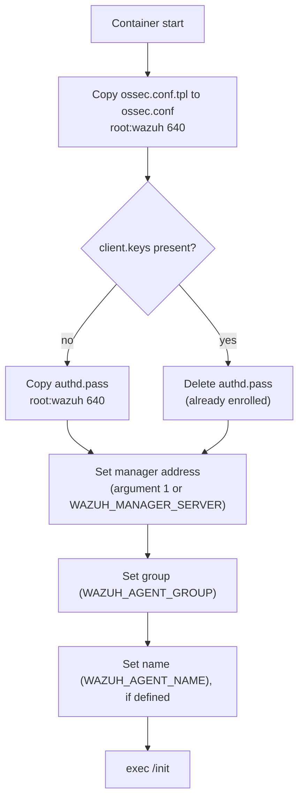

# `wazuh-agent-conf.sh` · agent startup and enrollment

**English** · [Español](README-wazuh-agent-conf.es.md)


Entrypoint of the Wazuh agent container. On every start it installs the base configuration from the repository, prepares the enrollment password only if the agent is not enrolled yet, sets the manager address, the group and (for the local agent) the agent name, and then hands control to the original entrypoint of the image.

## Overview

| Item | Value |
| --- | --- |
| **Location** | `scripts/wazuh-agent-conf.sh` (selected with `CONFIG_AGENT_SCRIPT` in `.env`) |
| **Runs on** | The `wazuh.agent` container: local agent on R4 and remote agents on R2 and R3 |
| **Run by** | Docker, as the container entrypoint (`/init_01.sh`) |
| **Reads** | `/opt/ossec.conf.tpl` ([`agent/conf/ossec.conf`](../agent/conf/ossec.conf)), `/opt/authd.pass`, `/var/ossec/etc/client.keys` |
| **Writes** | `/var/ossec/etc/ossec.conf`, `/var/ossec/etc/authd.pass` |
| **Hands over to** | `/init`, the entrypoint of the `wazuh/wazuh-agent` image |



## Usage

### Quick start

The script is not run by hand. It starts with the agent:

```bash
cd /home/wazuh
sudo ./scripts/wazuh-dev.sh agent     # remote agent (R2 or R3)
sudo ./scripts/wazuh-dev.sh server    # the local agent starts with the server stack (R4)
```

### How to

#### 1. Prerequisites

- `config/wazuh_cluster/authd.pass` written by `wazuh-dev.sh`. It is mounted as `/opt/authd.pass`.
- `agent/conf/ossec.conf` in the repository. It is mounted as `/opt/ossec.conf.tpl`.
- For the first enrollment, the manager reachable on `1515/tcp`, and the group already created by `wazuh-init`.

#### 2. Review how each agent calls it

| Agent | Compose file | Manager address | Group | Name |
| --- | --- | --- | --- | --- |
| Local (R4) | [`docker-compose.yml`](../docker-compose.yml) | `WAZUH_MANAGER_SERVER=127.0.0.1` | `LOCAL_AGENT_GROUP` (`monitoring`) | `WAZUH_AGENT_NAME` = `LOCAL_AGENT_HOSTNAME` |
| Remote (R2, R3) | [`agent/docker-compose-agent.yml`](../agent/docker-compose-agent.yml) | First argument: `REMOTE_AGENT_MANAGER_SERVER` | `REMOTE_AGENT_GROUP` (`databus` or `infobus`) | Container `hostname` = `LOCAL_AGENT_HOSTNAME` |

The local agent uses `network_mode: host`, where Compose cannot set the container host name. That is why its name goes into `<enrollment>` through `WAZUH_AGENT_NAME`.

#### 3. What the script does

1. Copies `/opt/ossec.conf.tpl` to `/var/ossec/etc/ossec.conf` and sets `root:wazuh 640`. Every start begins from the versioned configuration, so edits from earlier starts do not pile up.
2. If `client.keys` is missing or empty, copies `/opt/authd.pass` to `/var/ossec/etc/authd.pass` with `root:wazuh 640`, so the agent enrolls. If `client.keys` exists, deletes `authd.pass`: the agent is already enrolled and the password is not left on disk.
3. Takes the manager address from the first argument or, if there is none, from `WAZUH_MANAGER_SERVER`, and writes it into `<server><address>`.
4. If `WAZUH_AGENT_GROUP` is set, writes it into `<enrollment><groups>`.
5. If `WAZUH_AGENT_NAME` is set, adds `<agent_name>` inside `<enrollment>`.
6. Runs `exec /init` with the remaining arguments.

#### 4. Verify

```bash
docker logs --tail 30 wazuh.agent      # "Wazuh manager server", "Enrollment group" and the connection
docker exec wazuh.agent grep -A3 "<enrollment>" /var/ossec/etc/ossec.conf
```

On the server:

```bash
docker exec wazuh.manager /var/ossec/bin/agent_control -l
```

#### Common operations

To enroll an agent again (for example, after deleting it on the server), stop it, delete its key volume and deploy it again:

```bash
docker compose -f agent/docker-compose-agent.yml --env-file .env down
docker volume ls | grep wazuh_agent_etc        # find the agent volume
docker volume rm <volume>
sudo ./scripts/wazuh-dev.sh agent
```

## Reference

### Inputs

| Input | Required | Description |
| --- | --- | --- |
| Argument 1 | No | Manager address. Takes priority over `WAZUH_MANAGER_SERVER` |
| `WAZUH_MANAGER_SERVER` | If there is no argument | Manager address |
| `WAZUH_AGENT_GROUP` | No | Enrollment group |
| `WAZUH_AGENT_NAME` | No | Agent name in `<enrollment>` (local agent only) |
| `/opt/ossec.conf.tpl` | Yes | Base agent configuration |
| `/opt/authd.pass` | For the first enrollment | Enrollment password |

### Messages

| Message | Meaning |
| --- | --- |
| `client.keys not found: starting agent enrollment.` | First start: the agent enrolls with the password |
| `client.keys found: skipping enrollment.` | The agent already has a key; `authd.pass` is deleted |
| `Wazuh manager server: <address>` | Address written into `ossec.conf` |
| `Enrollment group: <group>` | Group written into `ossec.conf` |
| `Agent name: <name>` | Name written into `ossec.conf` |

## Security notes

- **Enrollment password:** it is copied into the agent only while the agent is not enrolled, and deleted once `client.keys` exists.
- **Permissions:** `ossec.conf` and `authd.pass` are `root:wazuh 640`.
- **Key:** `client.keys` lives in the `wazuh_agent_etc` volume. Deleting the volume forces a new enrollment.

## Documentation

- [`README.md`](../README.md#agent): agent deployment.
- [`agent/conf/ossec.conf`](../agent/conf/ossec.conf): agent base configuration.
- [`agent/docker-compose-agent.yml`](../agent/docker-compose-agent.yml): remote agent.
- [`docker-compose.yml`](../docker-compose.yml): local agent.
- [`scripts/wazuh-dev.sh`](wazuh-dev.sh): writes `authd.pass` and starts the agent. See [its README](README-wazuh-dev.md).
