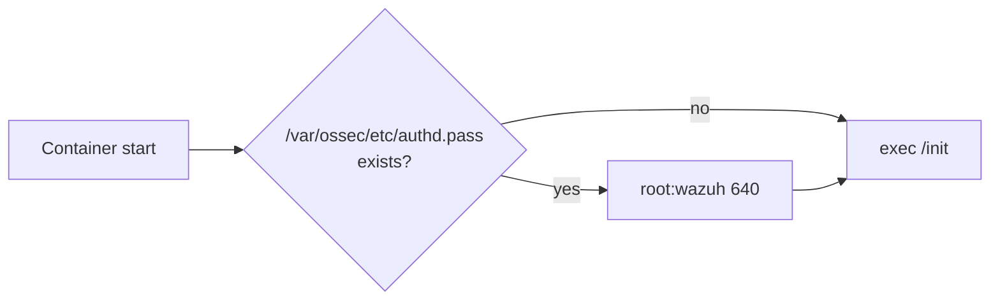

# `wazuh-conf-en.sh` · earlier agent post-install script (not in use)

**English** · [Español](README-wazuh-conf-en.es.md)


Earlier version of the agent entrypoint. It only fixed the permissions of a mounted `authd.pass` and handed control to the image entrypoint. [`wazuh-agent-conf.sh`](wazuh-agent-conf.sh) replaced it: no Compose file and no `.env.example` variable references this script.

## Overview

| Item | Value |
| --- | --- |
| **Location** | `scripts/wazuh-conf-en.sh` |
| **Status** | Not in use. Kept as reference |
| **Replaced by** | [`wazuh-agent-conf.sh`](wazuh-agent-conf.sh) (`CONFIG_AGENT_SCRIPT` in `.env`) |
| **Would run on** | A `wazuh/wazuh-agent` container, as its entrypoint |
| **Hands over to** | `/init`, the entrypoint of the image |



## Usage

### Quick start

Not used in the current deployment. To use it instead of `wazuh-agent-conf.sh`, it would have to be set as `CONFIG_AGENT_SCRIPT` in `.env`; that is not recommended (see [Differences](#differences-with-wazuh-agent-confsh)).

### How to

#### 1. What the script does

1. If `/var/ossec/etc/authd.pass` exists, sets it to `root:wazuh 640`.
2. Runs `exec /init` with the received arguments.

A commented block also installed the Python dependencies of the `docker-listener` wodle. The agent image ([`agent/Dockerfile`](../agent/Dockerfile)) installs them now.

#### 2. Verify that it is not in use

```bash
grep -rn "wazuh-conf-en" --include=*.yml --include=.env* .
```

No results means no service mounts it.

## Reference

### Differences with `wazuh-agent-conf.sh`

| Function | `wazuh-conf-en.sh` | `wazuh-agent-conf.sh` |
| --- | --- | --- |
| Install `ossec.conf` from the repository | No | Yes |
| Copy `authd.pass` only before enrollment | No (fixes permissions if mounted) | Yes |
| Delete `authd.pass` after enrollment | No | Yes |
| Set manager address | No | Yes |
| Set group | No | Yes |
| Set agent name | No | Yes |

`wazuh-conf-en.sh.BAK` is an older draft of a `wazuh-init` post-install script (wait for the API, then configure). [`wazuh-manager-conf.sh`](wazuh-manager-conf.sh) replaced it, and it is not used either.

## Documentation

- [`scripts/wazuh-agent-conf.sh`](wazuh-agent-conf.sh): current entrypoint. See [its README](README-wazuh-agent-conf.md).
- [`README.md`](../README.md): full deployment guide.
