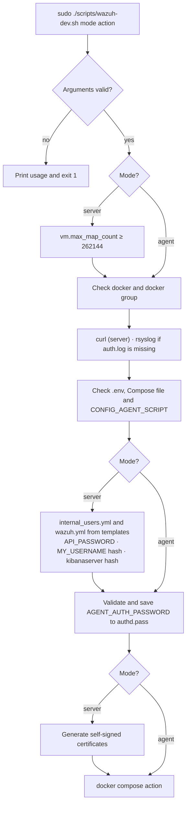

# `wazuh-dev.sh` · server and agent deployment

**English** · [Español](README-wazuh-dev.es.md)


-white?logo=linux)


Deployment script for the Wazuh stack. It prepares the host (kernel setting, `rsyslog`, credentials and certificates) and runs a Docker Compose action. It has two modes:

- **Server (`server`):** Wazuh Indexer, Manager, Dashboard, `wazuh-init` and the local agent, from [`docker-compose.yml`](../docker-compose.yml).
- **Agent (`agent`):** only the agent, from [`agent/docker-compose-agent.yml`](../agent/docker-compose-agent.yml).

## Overview

| Item | Value |
| --- | --- |
| **Location** | `scripts/wazuh-dev.sh` |
| **Runs on** | The host: R4 in `server` mode, R2 or R3 in `agent` mode |
| **Run by** | An administrator, as root (`sudo`) |
| **Reads** | `.env`, `config/wazuh_indexer/internal_users.yml.template`, `config/wazuh_dashboard/wazuh.yml.template` |
| **Writes** | `config/wazuh_cluster/authd.pass`, `.env` (`DOCKER_GID`); in `server` mode also `internal_users.yml`, `wazuh.yml`, `config/wazuh_indexer_ssl_certs/` and `/etc/sysctl.conf` |
| **Runs** | `docker compose up -d`, `down`, `restart`, `logs -f` or `ps` |



## Usage

### Quick start

```bash
cd /home/wazuh
cp .env.example .env                   # replace every "CAMBIAR"
sudo ./scripts/wazuh-dev.sh server     # on R4
sudo ./scripts/wazuh-dev.sh agent      # on R2 and R3
```

### How to

#### 1. Prerequisites

- Linux with Docker Engine and Docker Compose v2. The `docker` group must exist.
- Root access (`sudo`): the script changes a kernel setting, installs packages and writes credential files.
- `apt-get`, if `curl` (server) or `rsyslog` must be installed.
- A `.env` file in the repository root. If it does not exist, the script copies `.env.example` to `.env` and exits so that it can be edited first.

#### 2. Review the variables the script reads from `.env`

| Variable | Mode | Use in the script |
| --- | --- | --- |
| `CONFIG_AGENT_SCRIPT` | both | Agent startup script. Must exist; the script makes it executable |
| `LOCAL_AGENT_HOSTNAME` | both | Agent name. `localhost` is replaced with `hostname -f` and exported |
| `AGENT_AUTH_PASSWORD` | both | Enrollment password. Validated and saved to `config/wazuh_cluster/authd.pass` |
| `API_PASSWORD` | server | Manager API password. Validated and written to `config/wazuh_dashboard/wazuh.yml` |
| `MY_USERNAME`, `MY_PASSWORD` | server | Frontend administrator. Its hash is created or updated in `internal_users.yml` |
| `DASHBOARD_PASSWORD` | server | `kibanaserver` password. Validated and its hash updated in `internal_users.yml` |
| `DOCKER_GID` | both | Overwritten by the script with the `docker` group ID |

`API_PASSWORD`, `DASHBOARD_PASSWORD` and `AGENT_AUTH_PASSWORD` must:

- Have 8 to 64 characters.
- Contain at least one uppercase letter, one lowercase letter, one digit and one of `. * + ? -`.
- Contain no `$`, `|`, `&` or `\`.

`MY_PASSWORD` must not contain `$`, `|`, `&` or `\`. The rest of `.env` is read by Docker Compose. See the main [README](../README.md#2-configure-env).

#### 3. Run the script

```bash
cd /home/wazuh
sudo ./scripts/wazuh-dev.sh server        # same as: server up
```

The script does this, in order:

1. Validates the arguments: one or two, with `server` or `agent` first. Otherwise it prints the usage and exits with code `1`.
2. In `server` mode, raises `vm.max_map_count` to 262144 if it is lower, and adds the line to `/etc/sysctl.conf`.
3. Checks `docker` and the `docker` group.
4. In `server` mode, installs `curl` if it is missing.
5. If `/var/log/auth.log` does not exist, installs and starts `rsyslog`. If that fails, it continues with a warning: SSH events will not reach Wazuh.
6. Checks `.env` and the Compose file.
7. In `server` mode, creates `internal_users.yml` from its template if it is missing, and checks `generate-indexer-certs.yml`.
8. Checks `CONFIG_AGENT_SCRIPT` and makes it executable.
9. In `server` mode, creates `wazuh.yml` from its template if it is missing.
10. Resolves `LOCAL_AGENT_HOSTNAME` and exports it.
11. In `server` mode:
    1. Validates `API_PASSWORD` and writes it into `wazuh.yml`.
    2. Computes the `MY_PASSWORD` hash with the indexer image and updates `MY_USERNAME` in `internal_users.yml`, or adds it with the `admin` backend role.
12. Writes `DOCKER_GID` into `.env`.
13. In `server` mode, if `DASHBOARD_PASSWORD` is not `kibanaserver`, validates it and updates the `kibanaserver` hash. If it is still `kibanaserver`, it only warns.
14. Validates `AGENT_AUTH_PASSWORD` and saves it to `config/wazuh_cluster/authd.pass`.
15. In `server` mode, generates self-signed certificates in `config/wazuh_indexer_ssl_certs/`.
16. Runs the requested Docker Compose action.

#### 4. Verify

```bash
docker compose ps                                          # server
docker compose -f agent/docker-compose-agent.yml --env-file .env ps   # agent
```

A full server start takes several minutes: the dashboard waits until the indexer and the manager are healthy.

#### Common operations

```bash
sudo ./scripts/wazuh-dev.sh server ps         # status
sudo ./scripts/wazuh-dev.sh server logs       # follow the logs
sudo ./scripts/wazuh-dev.sh server restart    # restart the stack
sudo ./scripts/wazuh-dev.sh server down       # stop the stack; volumes are kept
sudo ./scripts/wazuh-dev.sh agent restart     # restart the agent
```

Every action runs the full preparation first (checks, hashes and, in `server` mode, certificates). For a quick status, `docker compose ps` is enough.

## Reference

### Arguments

| Position | Value | Required | Description |
| --- | --- | --- | --- |
| 1 | `server` or `agent` | Yes | Deployment mode |
| 2 | `up`, `down`, `restart`, `logs`, `ps` | No (default `up`) | Docker Compose action |

### Files created or changed

| File | Mode | When |
| --- | --- | --- |
| `/etc/sysctl.conf` | server | `vm.max_map_count` lower than 262144 |
| `config/wazuh_indexer/internal_users.yml` | server | Created from the template if missing; `MY_USERNAME` and `kibanaserver` hashes updated |
| `config/wazuh_dashboard/wazuh.yml` | server | Created from the template if missing; `password:` set to `API_PASSWORD` |
| `config/wazuh_cluster/authd.pass` | both | Always overwritten with `AGENT_AUTH_PASSWORD` |
| `config/wazuh_indexer_ssl_certs/` | server | The certificate generator runs on every server run |
| `.env` | both | `DOCKER_GID` line updated |

### Exit codes

| Code | Cause |
| --- | --- |
| `0` | Action finished |
| `1` | Wrong arguments or action, missing dependency, missing file or variable, or a password that does not meet the rules |
| Other | Exit code of `docker compose` |

## Security notes

- **Indexer `admin`:** the script does **not** change the `admin` hash. `INDEXER_PASSWORD` must match the hash in `internal_users.yml`. See the warning in the main [README](../README.md#2-configure-env).
- **Credential files:** `.env`, `authd.pass`, `internal_users.yml`, `wazuh.yml` and `config/wazuh_indexer_ssl_certs/` are in `.gitignore`. Never commit them.
- **`kibanaserver`:** if `DASHBOARD_PASSWORD` is left as `kibanaserver`, the default password stays in use.
- **Certificates:** they are self-signed. The generator runs on every server run, including `ps`, `logs`, `restart` and `down`.

## Documentation

- [`README.md`](../README.md): full deployment guide.
- [`docker-compose.yml`](../docker-compose.yml): server stack and local agent.
- [`agent/docker-compose-agent.yml`](../agent/docker-compose-agent.yml): remote agent.
- [`generate-indexer-certs.yml`](../generate-indexer-certs.yml): certificate generator.
- [`scripts/wazuh-manager-conf.sh`](wazuh-manager-conf.sh): run by `wazuh-init`. See [its README](README-wazuh-manager-conf.md).
- [`scripts/wazuh-agent-conf.sh`](wazuh-agent-conf.sh): agent startup. See [its README](README-wazuh-agent-conf.md).
