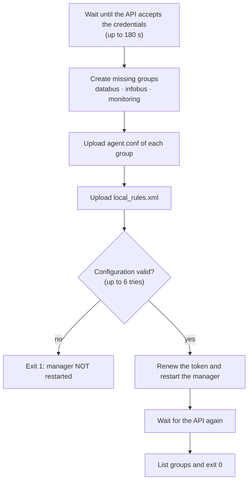

# `wazuh-manager-conf.sh` · groups, agent configuration and rules

**English** · [Español](README-wazuh-manager-conf.es.md)


Prepares the Wazuh manager before the agents enroll. The `wazuh-init` container runs it once, after the manager is healthy. Through the manager API it creates the agent groups, uploads each group's `agent.conf` and the project rules, validates the configuration and restarts the manager only if it is valid. It can run again without duplicating anything.

## Overview

| Item | Value |
| --- | --- |
| **Location** | `scripts/wazuh-manager-conf.sh` (selected with `CONFIG_SERVER_SCRIPT` in `.env`) |
| **Runs on** | The `wazuh-init` container on the server (R4), mounted as `/init.sh` |
| **Run by** | `docker compose up` (started by [`wazuh-dev.sh`](README-wazuh-dev.md) in `server` mode) |
| **Talks to** | Wazuh manager API at `WAZUH_API_URL` (port 55000) |
| **Creates** | Groups `databus`, `infobus` and `monitoring`; their `agent.conf`; `local_rules.xml` |
| **Tools** | `bash`, `curl`, `jq` (installed with `apk` if missing) |



## Usage

### Quick start

The script is not run by hand. It runs as part of the server deployment:

```bash
cd /home/wazuh
sudo ./scripts/wazuh-dev.sh server
```

To apply changes to groups, `agent.conf` or rules on an existing installation:

```bash
docker compose up -d wazuh-init
docker compose logs -f wazuh-init
```

### How to

#### 1. Prerequisites

- `wazuh.manager` healthy. `wazuh-init` waits for it in `docker-compose.yml`.
- `API_PASSWORD` already set by `wazuh-dev.sh`.
- `WAZUH_API_INSECURE=1` in `.env`. The manager certificate is self-signed; without this setting the script stops.

#### 2. Review the variables

| Variable | Default | Source in `docker-compose.yml` | Use |
| --- | --- | --- | --- |
| `WAZUH_API_URL` | `https://wazuh.manager:55000` | `API_URL` | Manager API address |
| `WAZUH_API_USER` | `wazuh-wui` | `API_USERNAME` | API user |
| `WAZUH_API_PASSWORD` | *(required)* | `API_PASSWORD` | API password |
| `WAZUH_API_INSECURE` | `0` | `.env` (`env_file`) | Must be `1`: accept the self-signed certificate |
| `DATABUS_PATH` | `/home/databus` | `DATABUS_PATH` | databus path **on the R3 host** |
| `INFOBUS_PATH` | `/home/infobus` | `INFOBUS_PATH` | infobus path **on the R2 host** |
| `WAZUH_PATH` | `/home/wazuh` | `WAZUH_PATH` | Path of this repository on R4 |
| `ZABBIX_PATH` | `/home/zabbix` | `ZABBIX_PATH` | Path of the Zabbix repository on R4 |

The paths are written into each group's `agent.conf`, so they must be the real paths on each agent host.

#### 3. What the script does

1. Installs `curl` and `jq` if they are missing.
2. Requires `WAZUH_API_INSECURE=1`.
3. Waits until the API accepts the credentials: one try every 5 s, up to 36 tries (180 s).
4. Creates the `databus`, `infobus` and `monitoring` groups if they do not exist.
5. Uploads the `agent.conf` of each group (see [Agent groups](#agent-groups)).
6. Uploads `local_rules.xml`, overwriting the previous one (see [Project rules](#project-rules)).
7. Validates the manager configuration: up to 6 tries, 5 s apart. If it is not `OK`, prints the details and exits **without** restarting the manager.
8. Logs in again, because the token lasts 900 s, and restarts the manager.
9. Waits until the API answers again, lists the groups with their agent count and exits with `0`.

#### 4. Verify

```bash
docker compose ps wazuh-init                    # Exited (0)
docker compose logs wazuh-init | tail -20       # ends with "The manager is ready to accept registrations"
```

In the frontend: **Agents management → Groups** shows the three groups, each with its `agent.conf`. **Server management → Rules → Custom rules** shows `local_rules.xml`.

#### Common operations

```bash
# Apply changes to agent.conf or rules after editing this script
docker compose up -d wazuh-init
docker compose logs -f wazuh-init

# Check the groups on the manager
docker exec wazuh.manager /var/ossec/bin/agent_groups -l
```

## Reference

### Agent groups

| Group | Host | Logs it reads | File integrity (FIM, real time) |
| --- | --- | --- | --- |
| `databus` | R3 | JSON logs of every container | `DATABUS_PATH` and the `databus_feed_files` volume. No diffs for `.env` and `.env.prod`; ignores `.git`, `*.log`, `*.tmp` and `__pycache__` |
| `infobus` | R2 | JSON logs of every container | `INFOBUS_PATH`. No diffs for `.env` and `.env.prod`; ignores `.git`, `*.log`, `*.tmp` and `__pycache__` |
| `monitoring` | R4 | `/var/log/auth.log` (SSH, with source IP) and JSON logs of every container | `WAZUH_PATH` and `ZABBIX_PATH`. No diffs for both `.env` and `authd.pass`; ignores `.git` and the certificates |

"No diffs" means Wazuh reports that the file changed but does not show its content, so credentials never appear in alerts.

### Project rules

They use the range reserved for local rules (100100 and up), in the `simovilab` group.

| Rule | Level | Based on | Detects |
| --- | --- | --- | --- |
| 100100 | 0 | JSON decoder, `stream` = stdout/stderr | Base: any container log line. Raises no alert |
| 100101 | 10 | 100100 | GTFS import failed in databus |
| 100102 | 8 | 100100 | Request rejected by `ALLOWED_HOSTS` |
| 100103 | 12 | 8 × 100102 in 120 s | Host name scan |
| 100104 | 7 | 100100 | Django 5xx response |
| 100105 | 3 | 100100 | 404 response |
| 100106 | 10 | 20 × 100105 in 60 s | Route enumeration |
| 100107 | 9 | 100100 | Redis authentication failed |
| 100108 | 3 | 100100 | infobus failed to process an update event |
| 100110 | 7 | 5 × 100108 in 300 s | Event retried without limit |
| 100111 | 5 | 100100 | Malformed event sent to the dead-letter queue |
| 100112 | 9 | 10 × 100111 in 600 s | Producer sending malformed events continuously |
| 100109 | 6 | 100100 | databus cloned code from GitHub at startup |
| 100120 | 12 | FIM 550, 553, 554 | A `.env` or `compose.prod.yml` changed |
| 100121 | 10 | FIM 550, 553, 554 | The GTFS published by databus changed |
| 100122 | 12 | FIM 550, 554 | The Docker socket changed |

### Exit codes

| Code | Cause |
| --- | --- |
| `0` | Groups, `agent.conf` and rules applied; manager restarted |
| `1` | `WAZUH_API_INSECURE` is not `1`, missing `curl` or `jq`, API not available in 180 s, rejected credentials, an operation rejected by the API, or invalid configuration |

## Security notes

- **TLS:** the script runs with `curl -k` because the certificate is self-signed. Use it only on the internal network.
- **Safe restart:** the manager is restarted only after the configuration passes validation.
- **Credentials:** `WAZUH_API_PASSWORD` comes from `.env`, which is in `.gitignore`.

## Documentation

- [`README.md`](../README.md#4-what-wazuh-init-configures): what `wazuh-init` configures.
- [`docker-compose.yml`](../docker-compose.yml): `wazuh-init` service.
- [`config/wazuh_cluster/wazuh_manager.conf`](../config/wazuh_cluster/wazuh_manager.conf): manager configuration.
- [`scripts/wazuh-dev.sh`](wazuh-dev.sh): deployment that starts `wazuh-init`. See [its README](README-wazuh-dev.md).
